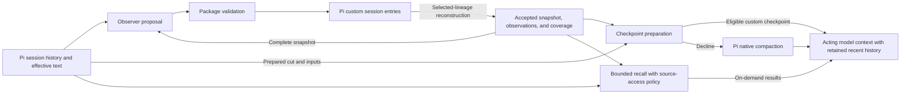

# Memory

## Purpose and scope

`@orbis/memory` prepares context for continuing work after the Pi coding-agent host compacts a conversation and provides bounded recall of earlier evidence within the active session branch and its ancestry. This specification defines the behavioral contract for independent implementers. An installable implementation is not available.

The core works independently. Project knowledge, developer habits, cross-session retrieval, topic consolidation, generated chronologies of earlier work, and user curation of derived memory are outside the MVP. Public companion and external-retrieval APIs require a concrete consumer. Provider-specific prefix reuse, request replay or warming, and reuse of unchanged summary segments are outside the MVP. Shortening checkpoint text in the background is not required.

The reference baseline is Pi 1.1.0's public extension and session capabilities. Later releases require verification of those capabilities; the baseline is not a runtime compatibility claim. Pi owns conversation history, compaction triggers, and the retained recent context. The package assumes one replacement-checkpoint owner while checking actual stored ownership when other extensions write checkpoints.

The research is informative. It does not establish that prepared memory improves continuation, preserves all relevant meaning, or reduces total cost compared with native Pi.

## Background and terms

Pi compaction replaces older model context with a checkpoint while retaining recent conversation. Memory prepares a continuation snapshot before that replacement and retains source-linked observations for on-demand recall. It distinguishes recorded evidence, accepted processing of that evidence, and the semantic information a model preserves; none of those guarantees the other two.

| Term                    | Meaning                                                                                                                                   |
| ----------------------- | ----------------------------------------------------------------------------------------------------------------------------------------- |
| Selected lineage        | The active session branch and ancestry selected by resume, fork, or tree navigation.                                                      |
| Original evidence       | Recorded source content before applicable context edits.                                                                                  |
| Effective text          | Source content after applicable Pi context edits, including replacements and omissions.                                                   |
| Checkpoint              | Native or custom compaction text presented before retained recent history.                                                                |
| Cut                     | Pi's prepared `firstKeptEntryId`, which identifies the first retained entry.                                                              |
| Split turn              | A turn divided by the cut; its earlier prefix must supply context for the retained continuation.                                          |
| Observer                | The auxiliary model that proposes memory updates.                                                                                         |
| Active obligations      | Protected goals, constraints, unfinished tasks, and waiting conditions.                                                                   |
| Maintained context      | Completed work, decisions and rationale, critical facts, and relevant identifiers.                                                        |
| Continuation snapshot   | The state needed to continue work, comprising active obligations and maintained context.                                                  |
| Protected string        | An exact identifier or original wording that every rendering keeps verbatim in its snapshot item.                                         |
| Observation             | A source-linked event or finding retained for recall.                                                                                     |
| Accepted state          | Validated memory reconstructed from records in the selected lineage.                                                                      |
| Observer job            | One bounded attempt against identified source versions and an accepted-state basis.                                                       |
| Source horizon          | The extent of semantic inputs in conversation order, including state dependencies, independently of observer commit position.             |
| Processing coverage     | Accepted processing of identified source portions and versions; it does not prove semantic preservation.                                  |
| Derived baseline        | An attributed checkpoint or branch summary used as evidence without claiming its originals were processed.                                |
| Candidate               | The custom checkpoint prepared for one compaction attempt.                                                                                |
| Catch-up                | Bounded processing by the same observer to prepare missing effective source coverage at the cut.                                          |
| Checkpoint state        | Accepted state, or an earlier accepted basis extended by catch-up that serves only that checkpoint.                                       |
| Condensation            | Shortening checkpoint presentation to fit capacity without changing accepted state.                                                       |
| Instructed presentation | Applying supplied compaction instructions to checkpoint presentation within its preservation rules.                                       |
| Native fallback         | Declining a custom result so Pi can perform native compaction while the host attempt remains active.                                      |
| File inventory          | Paths from recognized file-tool invocations through the checkpoint cut; it is not proof of successful filesystem effects.                 |
| Recall                  | On-demand retrieval of permitted source text or observations.                                                                             |
| Original view           | Historical source content before replacement or omission; recall access requires a personal configuration opt-in and an explicit request. |

The **acting prefix** is the initial part of the main agent's model request before newly appended conversation. Keeping it stable can support provider prompt caching; it does not guarantee a cache hit.

## Architecture overview

Pi session entries are authoritative storage. The observer proposes changes; package validation accepts a complete operation that updates the snapshot, observations, and processing coverage together. Reconstruction uses selected-lineage entries. Checkpoint preparation derives model-facing presentation from that state without making presentation changes authoritative. Recall independently applies source-access policy to evidence and observations.

The following component map is illustrative. It assigns responsibilities, not implementation modules.

## Specification areas

Read this root first, then the areas in the listed order. Shared terms and invariants apply throughout the set.

| Area                                    | Responsibility and when to read it                                                                                                                            |
| --------------------------------------- | ------------------------------------------------------------------------------------------------------------------------------------------------------------- |
| [Session state](specs/session-state.md) | Lineage reconstruction, activation, accepted observation updates, and continuation snapshots. Read before implementing or reviewing any memory state changes. |
| [Recall](specs/recall.md)               | Source discovery and access policy. Read before implementing or reviewing retrieval or uses of edited and original evidence.                                  |
| [Compaction](specs/compaction.md)       | Checkpoint eligibility, presentation and fallback, and cumulative file inventory. Read after state and recall to evaluate the complete preparation path.      |

## Invariants

### REQ-session-continuity — Session continuity

A package checkpoint provides the applicable native information categories: goals and scope; constraints and preferences; completed, active, paused, and blocked work with verification state; decisions and rationale; next actions and critical context; relevant exact identifiers; prior checkpoint information; split-turn context; and cumulative file information.

**Intent:** Preserve the information needed to choose the correct next action under the applicable instructions.

The semantic snapshot is self-contained. Render applicable checkpoint-state items in every category; observations remain recallable without becoming mandatory checkpoint sections. Recall cannot compensate for omitted critical continuation context. Distinguish intent, attempts, results, and verified completion. Preserve attribution and instruction authority. Record exact identifiers, and original wording where paraphrase would weaken constraints or acceptance criteria, as protected strings. Task-critical paths remain in obligations, decisions, verification state, or other critical continuation context even when the supplementary file inventory omits them. Their preservation does not depend on custom compaction instructions.

For every split turn, include the effective user request, relevant progress before the cut, and context needed to interpret the retained continuation. This applies with or without compaction instructions. Quoting the request alone does not satisfy missing progress or critical context.

**Scenarios:**

- Supply accepted items in every applicable category, a prior baseline, and items with protected identifiers and quotations; render a checkpoint. **Expected:** Every supplied applicable item is presented; protected strings are unchanged; baseline information is reconciled with newer evidence.
- Compact the same split turn with and without instructions. **Expected:** Both checkpoints include the effective request, progress before the cut, and context for the retained continuation.
- Omit a task-critical path from a capacity-limited supplement; compact with and without instructions. **Expected:** The applicable snapshot item still presents the exact path, including its obligation, decision, verification state, or continuation context.

### REQ-resource-budgets — Resource budgets

The package enforces documented finite limits on observation, foreground preparation, retries, concurrency, checkpoint size, and recall. Do not silently drop required items to meet a limit. Account for auxiliary work, failures, fallback, recall, and acting work without double-counting; mark unavailable usage as unknown.

**Intent:** Bound auxiliary work and make its complete cost and limits observable.

**Permitted choices:** Implementations choose and document model-aware numerical defaults within the finite limits above. These choices do not introduce unbounded work or weaken failure reporting.

**Scenarios:**

- Exhaust each configured work limit and supply missing usage counters. **Expected:** Work stops at the documented bound; required items are not silently discarded; each inference is counted once and unavailable usage is unknown.

### REQ-request-stability — Request stability

The package keeps fixed checkpoint rendering idempotent and deterministic, background revisions out of the acting prefix, and tool definitions stable across enablement changes. Put stable observer instructions and schemas before variable inputs. Lineage correctness, access revocation, and required corrections take precedence over cache stability. A native-checkpoint file supplement may change when available request capacity changes, under the file-inventory rule; it remains deterministic for identical inventory and capacity inputs. Stable tool definitions do not determine tool permissions.

**Intent:** Avoid unnecessary request changes without weakening correctness or access policy.

**Scenarios:**

- Compare request fixtures across unchanged state, background updates, and enablement changes. **Expected:** Fixed checkpoint text and tool definitions stay stable; background updates do not rewrite the acting prefix; permission revocation still takes effect.

## Security

The in-scope threats are permission claims introduced through edited or summarized text, disclosure of edited-out originals through recall, and use of stale or unrelated lineage state. The session-observation requirement preserves instruction authority; the recall requirement enforces personal original-access policy; the lineage requirement rejects stale state. These rules also apply during checkpoint preparation. Source references establish traceability, not semantic correctness or authorization.

The package does not sandbox other tools or extensions, erase content already copied into memory or checkpoints, or guarantee crash durability beyond Pi's persistence behavior. Those limits are explicit in the recall and lineage requirements. Semantic preservation and correct model interpretation require separate evaluation.

## Conformance

A conforming implementation satisfies every requirement and invariant in this specification set and the constraints and non-goals in Purpose and scope. Exact names and actions defined by the activation and recall requirements are external contracts. Present-tense statements and imperative obligations in these parts are mandatory. Uppercase SHOULD marks a recommendation an implementation may decline with a documented reason; uppercase MAY marks an allowed option. Text labeled Example or Note, Background and terms, Architecture overview, Security summaries, Explored alternatives, Supporting evidence, the illustrative diagrams, and linked research are informative. The requirement blocks define the authoritative behavior; diagrams illustrate it without adding transitions or exceptions.

Use local fixtures and scripted providers for automated checks, with no real-model calls. The scenarios beside each requirement check mechanics and preservation of supplied accepted state. An early scripted native-baseline harness is recommended for host integration. Separately authorized, bounded, supervised evaluations compare extracted information and subsequent actions with native Pi; these checks do not establish semantic parity, provider-cache savings, or lower total cost.

## Explored alternatives

- **Latest accepted state regardless of cut:** can apply retained-history events before their place in the conversation. Source horizons govern presentation instead.
- **Complete section rewrites on ordinary updates:** omission can remove still-applicable context; explicit operations preserve unmentioned items. Operations need structured identities and output.
- **Unrestricted historical-original recall:** can restore text removed for sensitive content. Personal opt-in permits deliberate access; temporary approvals and excluding originals entirely were not selected for the MVP.
- **Native summary plus memory sections as first delivery:** duplicates semantic content and changes the checkpoint-only design. It remains an optional evaluation comparison.
- **Routine snapshot injection:** adds changing ordinary-request state and another capacity path.
- **Move the cut to observed coverage:** changes Pi's prepared retention policy.
- **Separate gap summarizer or helper-owned recovery checkpoint:** adds another representation or inference owner; bounded same-observer catch-up and actual native fallback remain selected.
- **Dropping obligations or condensing authoritative state to fit:** can weaken accepted constraints; presentation condensation leaves that authority unchanged.
- **Checkpoints built only from selected observations:** adds selection risk for required context; the snapshot itself must supply applicable continuation information.
- **Separate authoritative storage or regeneration on resume:** adds lineage coordination or repeated inference; Pi entries follow the selected retention scope.
- **Full processing or start-only truncation of large tool results:** full processing makes eligibility costlier than native compaction; start-only truncation drops the end of logs, where failures usually appear. Observer-requested expansion of reduced excerpts is deferred until evaluation shows that excerpts lose needed evidence.
- **Rolling back or ignoring accepted state after a context edit:** rollback can force near-complete re-observation; ignoring edits can present removed text again. Flagging affected items without re-observation still presents that text.
- **Persisting checkpoint-only catch-up, or avoiding it through scheduling alone:** a persisted record adds a record type outside the main state; scheduling alone causes fallbacks inside long agent turns.
- **Position-tagged operations:** deriving earlier state by filtering operations by their cited source position trusts incomplete model citations.
- **Partial maintained-item input:** rotating or relevance-selected windows and a separate maintenance pass add selection machinery. A rotating window is deferred until suspension appears in evaluation.
- **Judging or passing through compaction instructions:** a model judgment of whether instructions are already satisfied costs a call and adds a failure mode; passing instructions through unchanged does not apply them to the checkpoint.
- **Instructed omission, or declining on a conflicting instruction:** omission weakens the inclusion check; declining discards the prepared checkpoint. Unapplied requests are reported instead.
- **Free-text presentation or rewritten obligation text:** inline identity markers make inclusion checks fragile, and rewriting obligations exposes protected constraints to paraphrase.
- **Mandatory archive replay or search during compaction:** adds cost and recovery dependencies; attributed derived baselines and optional recall cover the MVP needs.
- **Vectors, knowledge maintenance, and speculative companion APIs:** expand the core before a concrete consumer or evaluation establishes their value.

- **Separate instructed and condensation calls:** instructions can expand a fitting checkpoint and trigger another inference. One combined call bounds presentation work; repaired overflow falls back to native compaction.
- **All-or-nothing native inventory, or removing the supplement:** discards fitting cumulative path information. A bounded subset reports incompleteness without claiming exhaustive preservation.
- **Recency-first, directory-balanced, or snapshot-reference-first inventory:** needs additional ranking policy, including treatment of unknown inherited timestamps or semantic links. Native read-first ordering does not prioritize write/edit targets. Selection quality needs evaluation; the semantic snapshot preserves critical paths independently of inventory ranking.
- **Freeze a selected subset until compaction:** avoids capacity-induced prefix changes but can require dropping the entire supplement after context growth or a smaller-model switch.
- **Trust replacement text's preserved role, or forbid every obligation change from edits:** the former can grant unsupported permission; the latter blocks ordinary attributed corrections.
- **Require a fresh post-edit confirmation or an explicit authorization command:** excludes otherwise applicable independent instructions and adds interaction. Permission support can precede or follow an edit without a special command.
- **Require independent instructions for every obligation change:** treats factual and task-status corrections as permission grants. The stricter rule applies when a change permits additional actions.
- **Configured mappings for other file tools:** expands recognition and configuration beyond the Pi tool contract. Reconsider for a concrete tool integration; arbitrary shell effects remain outside invocation-based inventory.

## Supporting evidence

This section is informative and does not add requirements. It links each requirement to the research behind it and names the outcome that still needs measurement. The [research index](docs/research/README.md) lists the research. A link marked `Observed in` points to host behavior inspected at that version; other links point to reasoning. The [evaluation design](docs/research/evidence-and-evaluation.md#proposed-evaluation-design) separates construction loss, retrieval failure, and incorrect use.

| Requirement                                                                                      | Supporting evidence                                                                                                                                                                                                                                                                                                                                                                                                                                | Open measurement                                                                                                                                                                                             |
| ------------------------------------------------------------------------------------------------ | -------------------------------------------------------------------------------------------------------------------------------------------------------------------------------------------------------------------------------------------------------------------------------------------------------------------------------------------------------------------------------------------------------------------------------------------------- | ------------------------------------------------------------------------------------------------------------------------------------------------------------------------------------------------------------ |
| [Session continuity](#req-session-continuity--session-continuity)                                | **Observed in Pi 1.1.0:** [native information categories](docs/research/pi-compaction.md#native-checkpoint-information). [Continuation analysis](docs/research/continuity-and-invariants.md); [critical-path preservation](docs/research/presentation-inventory-and-authority.md#implications-for-design-and-evaluation).                                                                                                                          | Whether checkpoints preserve required information and lead to correct subsequent actions across repeated compactions, compared with native Pi on representative tasks.                                       |
| [Session observations](specs/session-state.md#req-session-observations--session-observations)    | **Observed in Pi 1.1.0:** [Pi source scope](docs/research/pi-compaction.md#actual-source-coverage). [Observational-memory comparison](docs/research/observational-memory-comparison.md); [reduction and edit rationale](docs/research/continuity-and-invariants.md#1-allocate-native-information-without-duplicating-a-summary); [edited authority](docs/research/presentation-inventory-and-authority.md#context-edit-attribution-and-authority). | Extraction loss, information lost to tool-result reduction, valid empty acceptance, stale work, and logical commit recovery.                                                                                 |
| [Continuation snapshot](specs/session-state.md#req-continuation-snapshot--continuation-snapshot) | [Structured updates](docs/research/continuity-and-invariants.md#1-allocate-native-information-without-duplicating-a-summary); [structured condensation](docs/research/continuity-and-invariants.md#4-handle-an-oversized-snapshot); [presentation call bounds](docs/research/presentation-inventory-and-authority.md#request-capacity-and-presentation-calls).                                                                                     | Whether reviewing the complete snapshot retires superseded work and keeps needed decisions and context before input capacity becomes limiting.                                                               |
| [Source recall](specs/recall.md#req-source-recall--source-recall)                                | **Observed in Pi 1.1.0:** [original and effective records](docs/research/pi-compaction.md#original-records-and-effective-context). [Retrieval and use](docs/research/evidence-and-evaluation.md#retrieval-construction-loss-and-reader-behavior).                                                                                                                                                                                                  | Whether acting models discover and use details omitted by extraction through bounded literal recall, with correct attribution.                                                                               |
| [Session lineage](specs/session-state.md#req-session-lineage--session-lineage)                   | **Observed in Pi 1.1.0:** [persistence and ancestry](docs/research/pi-compaction.md#persistence-and-selected-lineage).                                                                                                                                                                                                                                                                                                                             | Resume, forks, context edits, corruption, and uncertain appends through real host fixtures.                                                                                                                  |
| [Unified compaction](specs/compaction.md#req-unified-compaction--unified-compaction)             | **Observed in Pi 1.1.0:** [hook outcomes](docs/research/pi-compaction.md#hook-outcomes-failure-and-retry). [Recovery trade-offs](docs/research/continuity-and-invariants.md#2-handle-unprocessed-evidence-at-the-prepared-cut).                                                                                                                                                                                                                    | Whether catch-up recovers enough checkpoints to justify foreground waiting and auxiliary cost; prepared-cut preservation, instruction failure, external checkpoints, and repeated custom/native transitions. |
| [File inventory](specs/compaction.md#req-file-inventory--file-inventory)                         | **Observed in Pi 1.1.0:** [native inheritance limit](docs/research/pi-compaction.md#file-operation-history-is-an-exception). [Bounded supplement](docs/research/continuity-and-invariants.md#3-define-whole-checkpoint-fallback-and-its-reports); [native file policies and capacity](docs/research/presentation-inventory-and-authority.md).                                                                                                      | Whether the supplement preserves useful cumulative context across custom and native checkpoints at reasonable integration cost, including incomplete-source reports.                                         |
| [Memory activation](specs/session-state.md#req-memory-activation--memory-activation)             | **Observed in Pi 1.1.0:** [session persistence and lineage](docs/research/pi-compaction.md#persistence-and-selected-lineage). [Explicit-activation precedent](docs/research/observational-memory.md#compaction-and-coverage).                                                                                                                                                                                                                      | Disabled observation and file supplement with policy-consistent recall; fork and resume inheritance.                                                                                                         |
| [Resource budgets](#req-resource-budgets--resource-budgets)                                      | [Evaluation controls](docs/research/evidence-and-evaluation.md#reporting-and-controls).                                                                                                                                                                                                                                                                                                                                                            | Foreground delay, bounded work, fallback frequency, observer overhead, and complete task cost.                                                                                                               |
| [Request stability](#req-request-stability--request-stability)                                   | **Observed in Pi 1.1.0:** [stable checkpoint presentation](docs/research/prompt-caching-and-compaction.md#stable-checkpoint-presentation).                                                                                                                                                                                                                                                                                                         | Stable constructed requests across unchanged state, measured separately from provider cache behavior.                                                                                                        |

## References

- [Pi 1.1.0 extension contract](https://github.com/earendil-works/pi/blob/v1.1.0/packages/coding-agent/src/core/extensions/types.ts).
- [Pi 1.1.0 session contract](https://github.com/earendil-works/pi/blob/v1.1.0/packages/coding-agent/src/core/session-manager.ts).
