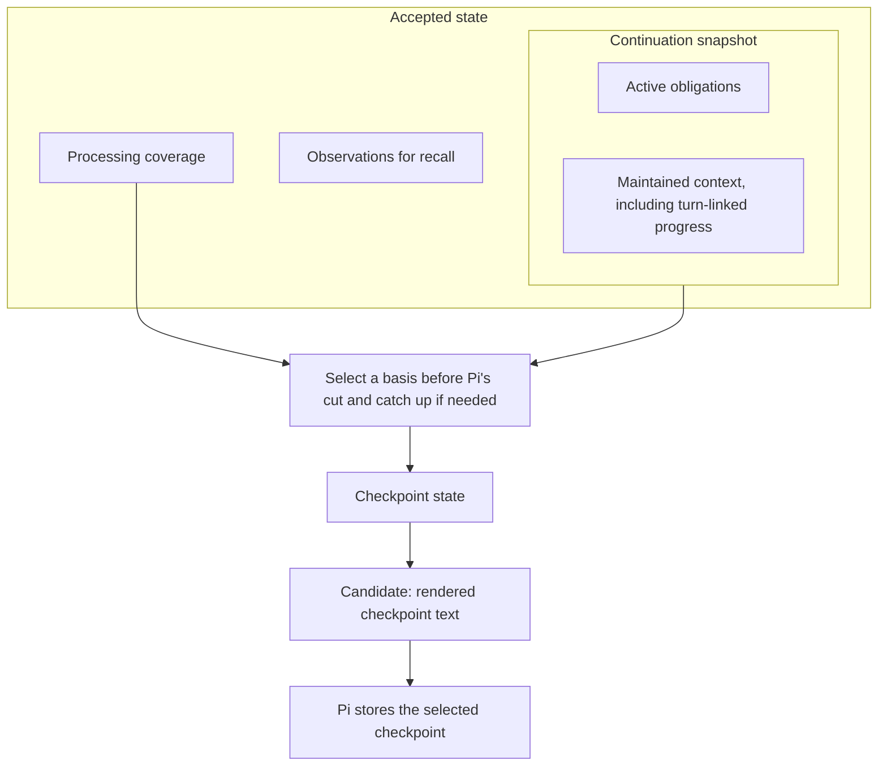
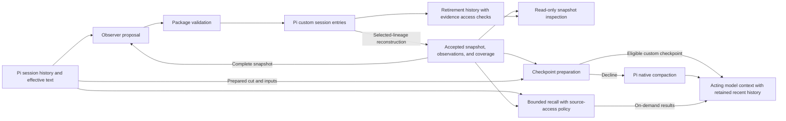

# Memory

## Purpose and scope

Long-running repository work needs unfinished obligations, governing decisions, verification state, and exact artifact paths after earlier conversation leaves the model context. Native Pi requests these details in generated summaries, but does not maintain an explicit evidence-linked lifecycle for each obligation or provide independent bounded discovery of the underlying session evidence. Developers and coding agents need inspectable continuation state and access to that evidence when a summary is insufficient.

While enabled, `@orbis/memory` prepares continuation state as a Pi coding-agent session progresses and supplies custom checkpoints during compaction. These checkpoints replace Pi's native summaries; native summarization remains the fallback when custom checkpoint preparation cannot meet the contract. Bounded recall retrieves earlier evidence within the active session branch and its ancestry.

The core works independently. Project knowledge, developer habits, cross-session retrieval, topic consolidation, generated chronologies of earlier work, and user curation of derived memory are outside the MVP. Public APIs for other packages or external retrieval require a concrete consumer. Provider-specific prefix reuse, replaying earlier model requests, sending requests to populate provider caches, and reusing unchanged summary segments are outside the MVP. A separate background model for checkpoint presentation or rewriting accumulated memory is outside the MVP.

The reference baseline is Pi 1.1.0's public extension and session capabilities. Later releases require verification of those capabilities; the baseline is not a runtime compatibility claim. Pi owns conversation history and controls compaction triggers, the retained-history boundary, checkpoint persistence, and overflow retry. Memory supplies replacement checkpoint text through Pi's before-compaction hook. The package assumes one extension owns checkpoint replacement and checks whether the stored checkpoint is its own when other extensions also write checkpoints.

A file supplement adds cumulative file-path information to acting requests that use a native checkpoint. Virtual acting models can route requests to different concrete models. Custom checkpoints and file supplements require a trustworthy request-capacity bound; without one, those sessions use native compaction and omit the supplement, potentially throughout the session. The observer uses a concrete model. If the captured observer selection is virtual, auxiliary inference suspends until personal configuration selects a concrete observer. Selecting a concrete observer does not establish the separate acting request's capacity. Known configuration and hard capacity blockers produce automatic notices; transient failures warn only when repeated. All failures remain visible in status.

The research is informative. It does not establish that prepared memory improves continuation, preserves all relevant meaning, or reduces total cost compared with native Pi.

## Background and terms

Pi compaction replaces older model context with a checkpoint while retaining recent conversation. Memory prepares a continuation snapshot before that replacement and retains source-linked observations for on-demand recall. It distinguishes recorded evidence, accepted processing of that evidence, and the semantic information a model preserves; none of those guarantees the other two.

| Term                    | Meaning                                                                                                                                            |
| ----------------------- | -------------------------------------------------------------------------------------------------------------------------------------------------- |
| Selected lineage        | The active session branch and ancestry selected by resume, fork, or tree navigation.                                                               |
| Original evidence       | Recorded source content before applicable context edits.                                                                                           |
| Effective text          | Source content after applicable Pi context edits, including replacements and omissions.                                                            |
| Checkpoint              | Native or custom compaction text presented before retained recent history.                                                                         |
| Cut                     | Exclusive checkpoint boundary identified by Pi's prepared `firstKeptEntryId`; that entry and later entries remain in recent history.               |
| Split turn              | A user request and its assistant/tool continuation divided by the cut; its earlier prefix must supply context for the retained continuation.       |
| Observer                | The auxiliary model that proposes memory updates.                                                                                                  |
| Active obligations      | Protected goals, constraints, unfinished tasks, and waiting conditions.                                                                            |
| Maintained context      | Completed work, decisions and rationale, critical facts, and relevant identifiers.                                                                 |
| Continuation snapshot   | The state needed to continue work, comprising active obligations and maintained context.                                                           |
| Protected string        | An exact identifier or original wording that every rendering keeps verbatim in its snapshot item.                                                  |
| Observation             | A source-linked event or finding retained for recall.                                                                                              |
| Accepted state          | Validated snapshot, observations, and processing coverage reconstructed from records in the selected lineage.                                      |
| Observer job            | One bounded attempt against identified source versions and an accepted-state basis.                                                                |
| Source horizon          | The latest source position contributing to a state, including evidence inherited from earlier state; the observer commit position does not set it. |
| Processing coverage     | Accepted processing of identified source portions and versions; it does not prove semantic preservation.                                           |
| Derived baseline        | An attributed checkpoint or branch summary used as evidence without claiming its originals were processed.                                         |
| Candidate               | The custom checkpoint prepared for one compaction attempt.                                                                                         |
| Catch-up                | Bounded processing by the same observer to prepare missing effective source coverage at the cut.                                                   |
| Checkpoint state        | Accepted state, or an earlier accepted basis extended by catch-up that serves only that checkpoint.                                                |
| Condensation            | Shortening checkpoint presentation to fit capacity without changing accepted state.                                                                |
| Instructed presentation | Applying supplied compaction instructions to checkpoint presentation within its preservation rules.                                                |
| Native fallback         | Declining a custom result so Pi can perform native compaction while the host attempt remains active.                                               |
| File inventory          | Paths from recognized file-tool invocations through the checkpoint cut; it is not proof of successful filesystem effects.                          |
| Recall                  | On-demand retrieval of permitted source text or observations.                                                                                      |
| Original view           | Historical source content before replacement or omission; recall access requires a personal configuration opt-in and an explicit request.          |

**Personal configuration** means user-controlled configuration stored outside the project tree. Project settings cannot select, redirect, replace, or override this source. Implementations document its location and validation.

The **acting prefix** is the initial part of the main agent's model request before newly appended conversation. Keeping it stable can support provider prompt caching; it does not guarantee a cache hit.

## Architecture overview

Pi session entries are authoritative storage. The observer proposes changes; package validation accepts a complete operation that updates the snapshot, observations, and processing coverage together. Reconstruction uses selected-lineage entries.

During compaction, memory renders a checkpoint from the state applicable to Pi's prepared cut. Rendering and shortening that text do not update accepted memory. Pi stores the selected checkpoint and presents it with retained recent history on subsequent acting-model requests. Recall independently applies source-access policy to evidence and observations. `/memory inspect` shows accepted snapshot items and recorded obligation retirements without running a model. Inspection describes stored state; it does not certify that extraction or retirement was correct.

Accepted state has three parts: the continuation snapshot, observations for recall, and processing coverage. The snapshot has active obligations and maintained context. Checkpoint preparation selects a compatible accepted state or extends an earlier basis with bounded catch-up; that prepared state is the checkpoint state. A candidate is its rendered text for one compaction attempt, not another persistent memory store.

The following state map is illustrative. The arrows below the accepted-state box describe preparation rather than containment.

The following component map is illustrative. It assigns responsibilities, not implementation modules.

## Specification areas

Read this root first, then the areas in the listed order. Shared terms and invariants apply throughout the set.

| Area                                     | Responsibility and when to read it                                                                                                                            |
| ---------------------------------------- | ------------------------------------------------------------------------------------------------------------------------------------------------------------- |
| [Session state](specs/session-state.md)  | Lineage reconstruction, activation, accepted observation updates, and continuation snapshots. Read before implementing or reviewing any memory state changes. |
| [Recall and inspection](specs/recall.md) | Source discovery, snapshot inspection, retirement history, and access policy. Read before implementing or reviewing state inspection or evidence access.      |
| [Compaction](specs/compaction.md)        | Checkpoint eligibility, presentation and fallback, and cumulative file inventory. Read after state and recall to evaluate the complete preparation path.      |

## Invariants

### REQ-session-continuity — Session continuity

A package checkpoint provides the applicable native information categories: goals and scope; constraints and preferences; completed, active, paused, and blocked work with verification state; decisions and rationale; next actions and critical context; relevant exact identifiers; prior checkpoint information; split-turn context; and cumulative file information.

**Intent:** Preserve the information needed to choose the correct next action under the applicable instructions.

The semantic snapshot is self-contained. Render applicable checkpoint-state items in every category; observations remain recallable without becoming mandatory checkpoint sections. Recall cannot compensate for omitted critical continuation context. Distinguish intent, attempts, results, and verified completion. Preserve attribution and instruction authority. Record exact identifiers, and original wording where paraphrase would weaken constraints or acceptance criteria, as protected strings. Task-critical paths remain in obligations, decisions, verification state, or other critical continuation context even when the supplementary file inventory omits them. Their preservation does not depend on custom compaction instructions.

**Scenarios:**

- Supply accepted items in every applicable category, a prior baseline, and items with protected identifiers and quotations; render a checkpoint. **Expected:** Every supplied applicable item is presented; protected strings are unchanged; baseline information is reconciled with newer evidence.
- Omit a task-critical path from a capacity-limited supplement; compact with and without instructions. **Expected:** The applicable snapshot item still presents the exact path, including its obligation, decision, verification state, or continuation context.

### REQ-resource-budgets — Resource budgets

The package enforces documented finite limits on observation, foreground preparation, retries, concurrency, checkpoint size, and recall. Do not silently drop required items to meet a limit.

**Intent:** Bound auxiliary work without silently weakening preservation.

**Permitted choices:** Implementations choose and document model-aware numerical defaults within the finite limits above. These choices do not introduce unbounded work or weaken failure reporting.

**Scenarios:**

- Exhaust a configured work limit. **Expected:** Work stops at the documented bound and reports the limit; required items are not silently discarded.

### REQ-usage-accounting — Usage accounting

Account for observation, catch-up, presentation, failed and rejected inference, native fallback, recall, and acting work without double-counting. Report unavailable usage as unknown. Attribute work to its operation and model so native fallback does not conceal preceding auxiliary cost.

**Intent:** Make total work observable even when inference produces no accepted memory.

**Scenarios:**

- Reject an observer response, retry once, then decline to native compaction. **Expected:** Each inference appears once in accounting, including the rejected attempt and the native call.
- Receive an outcome without provider usage. **Expected:** Its usage is unknown rather than zero.

### REQ-request-stability — Request stability

The package keeps fixed checkpoint rendering idempotent and deterministic, background revisions out of the acting prefix, and tool definitions stable across enablement changes. Lineage correctness, access revocation, and required corrections take precedence over cache stability. A native-checkpoint file supplement may change when available request capacity changes, under the file-inventory rule; it remains deterministic for identical inventory and capacity inputs. Stable tool definitions do not determine tool permissions.

**Intent:** Avoid unnecessary request changes without weakening correctness or access policy.

**Scenarios:**

- Compare request fixtures across unchanged state, background updates, and enablement changes. **Expected:** Fixed checkpoint text and tool definitions stay stable; background updates do not rewrite the acting prefix; permission revocation still takes effect.

## External contracts

| Contract                   | Exact surface                                                                 | Defined behavior                                                                                                   |
| -------------------------- | ----------------------------------------------------------------------------- | ------------------------------------------------------------------------------------------------------------------ |
| Enable auxiliary memory    | `/memory on`                                                                  | [Memory activation](specs/session-state.md#req-memory-activation--memory-activation)                               |
| Inspect continuation state | `/memory inspect`                                                             | [State inspection](specs/recall.md#req-state-inspection--state-inspection)                                         |
| Retrieve session evidence  | `memory_recall`, with `browse`, `search`, and `read` actions                  | [Source recall](specs/recall.md#req-source-recall--source-recall)                                                  |
| Replace Pi compaction      | Public `session_before_compact` result preserving prepared `firstKeptEntryId` | [Unified compaction](specs/compaction.md#req-unified-compaction--unified-compaction) and the Pi reference contract |

Other command spelling, settings paths, persisted schemas, and recall argument encodings remain documented implementation choices within their requirements. Personal configuration's location remains outside the project tree regardless of those choices.

## Security

The package addresses permission claims introduced through edited or summarized text, unauthorized original recall, stale lineage state, and unauthorized observer destinations. [Edited-evidence authority](specs/session-state.md#req-edited-evidence-authority--edited-evidence-authority), [original access](specs/recall.md#req-original-access--original-access), [session lineage](specs/session-state.md#req-session-lineage--session-lineage), and [observer configuration](specs/session-state.md#req-observer-configuration--observer-configuration) define those boundaries. Source references establish traceability, not semantic correctness or authorization.

Enabling memory permits bounded session processing by the selected observer. Its input includes the complete snapshot and selected effective conversation text, which can include assistant thinking, tool arguments and results, and derived summaries. An observer can use a different provider from the acting model; Pi's provider configuration determines its account. Memory does not select accounts independently. [Observer dispatch](specs/session-state.md#req-observer-dispatch--observer-dispatch) delegates default credential and endpoint resolution to Pi for the captured concrete provider/model. Personal endpoint overrides bind their destination and credential selection separately. Virtual observers are outside the MVP. Credentials stay outside prompts and persisted memory.

Context edits are not an erasure mechanism. Re-observation can revise copied content, but an edit alone does not delete snapshot items or stored checkpoints. Copied edited-out text can therefore reach an observer through the snapshot or an acting model through a checkpoint even when original recall is denied. The current snapshot inspection exposes that same copied state with edit attribution. The original-access opt-in controls source reads and edited-source retirement history, not inspection of the current snapshot. Pi does not identify whether an edit removes a secret or performs overflow recovery, so omission alone does not cancel an obligation.

Pi and its loaded provider implementations are trusted. The package does not attest other extensions' provider registrations or freeze Pi's credential configuration. It does not sandbox other tools or extensions, revoke data already sent to a provider, redact the session archive, or guarantee crash durability beyond Pi. Semantic preservation and correct model interpretation require separate evaluation.

## Conformance

A conforming implementation satisfies every requirement and invariant in this specification set and the constraints and non-goals in Purpose and scope. The exact names and values in External contracts are binding. Present-tense statements and imperative obligations in these parts are mandatory. Uppercase SHOULD marks a recommendation an implementation may decline with a documented reason; uppercase MAY marks an allowed option. Text labeled Example or Note, Background and terms, Architecture overview, Security summaries, Explored alternatives, Supporting evidence, the illustrative diagrams, and linked research are informative. The requirement blocks define the authoritative behavior; diagrams illustrate it without adding transitions or exceptions.

Use local fixtures and scripted providers for automated checks, with no real-model calls. The scenarios beside each requirement check mechanics and preservation of supplied accepted state. An early scripted native-baseline harness is recommended for host integration. These scripted checks do not establish semantic parity, provider-cache savings, or lower total cost. Separately authorized, bounded, supervised evaluations compare extracted information and subsequent actions with native Pi.

## Explored alternatives

### Checkpoint state and recovery

- **Latest accepted state regardless of cut:** can apply retained-history events before their place in the conversation. Source horizons govern presentation instead.
- **Native summary plus memory sections as first delivery:** duplicates semantic content and changes the checkpoint-only design. It remains an optional evaluation comparison.
- **Routine snapshot injection:** adds changing ordinary-request state and another capacity path.
- **Move the cut to observed coverage:** changes Pi's prepared retention policy.
- **Separate gap summarizer or helper-owned recovery checkpoint:** adds another representation or inference owner; bounded same-observer catch-up and actual native fallback remain selected.
- **Checkpoints built only from selected observations:** adds selection risk for required context; the snapshot itself must supply applicable continuation information.
- **Separate authoritative storage or regeneration on resume:** adds lineage coordination or repeated inference; Pi entries follow the selected retention scope.
- **Persisting checkpoint-only catch-up, or avoiding it through scheduling alone:** a persisted record adds a record type outside the main state; scheduling alone causes fallbacks inside long agent turns.
- **Position-tagged operations:** deriving earlier state by filtering operations by their cited source position trusts incomplete model citations.
- **Mandatory archive replay or search during compaction:** adds cost and recovery dependencies; attributed derived baselines and optional recall cover the MVP needs.

### Snapshot maintenance and presentation

- **Complete section rewrites on ordinary updates:** omission can remove still-applicable context; explicit operations preserve unmentioned items. Operations need structured identities and output.
- **Dropping obligations or condensing authoritative state to fit:** can weaken accepted constraints; presentation condensation leaves that authority unchanged.
- **Full processing or start-only truncation of large tool results:** full processing makes eligibility costlier than native compaction; start-only truncation drops the end of logs, where failures usually appear. Observer-requested expansion of reduced excerpts is deferred until evaluation shows that excerpts lose needed evidence.
- **Partial maintained-item input:** rotating or relevance-selected windows and an additional model job to review stored items independently of new evidence add selection machinery. A rotating window is deferred until suspension appears in evaluation.
- **Judging or passing through compaction instructions:** a model judgment of whether instructions are already satisfied costs a call and adds a failure mode; passing instructions through unchanged does not apply them to the checkpoint.
- **Instructed omission, or declining on a conflicting instruction:** omission weakens the inclusion check; declining discards the prepared checkpoint. Unapplied requests are reported instead.
- **Free-text presentation or rewritten obligation text:** inline identity markers make inclusion checks fragile, and rewriting obligations exposes protected constraints to paraphrase.
- **Separate instructed and condensation calls:** instructions can expand a fitting checkpoint and trigger another inference. One combined call bounds presentation work; overflow after restoring item text omitted or stripped of protected strings falls back to native compaction.

### Source access and authority

- **Unrestricted historical-original recall:** can restore text removed for sensitive content. Personal opt-in permits deliberate access; temporary approvals and excluding originals entirely were not selected for the MVP.
- **Rolling back or ignoring accepted state after a context edit:** rollback can force near-complete re-observation; ignoring edits can present removed text again. Flagging affected items without re-observation still presents that text.
- **Trust replacement text's preserved role, or forbid every obligation change from edits:** the former can grant unsupported permission; the latter blocks ordinary attributed corrections.
- **Require a fresh post-edit confirmation or an explicit authorization command:** excludes otherwise applicable independent instructions and adds interaction. Permission support can precede or follow an edit without a special command.
- **Require independent instructions for every obligation change:** treats factual and task-status corrections as permission grants. The stricter rule applies when a change permits additional actions.

### Inspection and retirement visibility

- **Paginated inspection with revision-bound cursors:** duplicates the recall tool's navigation machinery for a human-facing report. Produce a complete bounded report or a size failure; reconsider paging if real inspection histories make that limit impractical.
- **Remove the inspectability goal:** leaves the user unable to examine the state that checkpoint preparation uses. A bounded read-only command provides that visibility without adding inference.
- **Rely on recall to reveal mistaken retirement:** source retention does not tell the agent to search for a missing obligation. Inspection exposes accepted retirements and their evidence, but detecting a semantic mistake still requires review.
- **Append retirement logs to every checkpoint:** adds context and cost without proving a retirement correct. Keep the resulting checkpoint state and provide separate inspection.
- **Approve each retirement or add a verifier model:** adds interaction or inference to automatic maintenance. Reconsider only if measured retirement failures justify that cost; ordinary source instructions can correct state.

### File inventory and future scope

- **Vectors, knowledge maintenance, and speculative companion APIs:** expand the core before a concrete consumer or evaluation establishes their value.
- **All-or-nothing native inventory, or removing the supplement:** discards fitting cumulative path information. A bounded subset reports incompleteness without claiming exhaustive preservation.
- **Recency-first, directory-balanced, or snapshot-reference-first inventory:** needs additional ranking policy, including treatment of unknown inherited timestamps or semantic links. Pi lists read-only paths before write/edit paths, which does not prioritize write/edit targets. Selection quality needs evaluation; the semantic snapshot preserves critical paths independently of inventory ranking.
- **Freeze a selected subset until compaction:** avoids capacity-induced prefix changes but can require dropping the entire supplement after context growth or a smaller-model switch.
- **Configured mappings for other file tools:** expands recognition and configuration beyond the Pi tool contract. Reconsider for a concrete tool integration; arbitrary shell effects remain outside invocation-based inventory.

### Capacity and configuration

- **Assume virtual metadata or the last physical model bounds every route:** neither limits an arbitrary router. Require an enforced request bound; otherwise use native compaction and report the limitation.
- **Dispatch queued work on the former observer after an explicit model change:** can continue spending on a model the user replaced. Cancel queued work, request cancellation of in-flight inference, and reject its late results; already dispatched work can still incur charges.
- **Package-specific account overrides:** add provider-specific selectors without a concrete MVP consumer. Delegate account selection to Pi and reconsider an independent selector only for an identified integration.
- **Policy-based virtual observers:** Pi does not declare every possible destination or constrain router-internal calls, and no cooperating router is identified. Require a concrete observer in personal configuration when the captured observer selection is virtual; reconsider dynamic observer routing when a concrete cooperating integration exists.
- **Warn and announce recovery for every failed attempt:** makes isolated timeouts noisy. Report known configuration and hard capacity blockers immediately; require repeated transient failure before warning and announce recovery only after a warning.
- **Report degradation only when status is requested:** can conceal continued auxiliary spending. Keep automatic notices for persistent or repeated conditions and status for every failure.
- **Stop observation after presentation overflow:** prevents new source from retiring or superseding work. Continue bounded observation while its complete input fits, but suppress presentation retries without improved fit.
- **Retry condensation after every state change:** unrelated evidence can add cost without improving capacity. Compare deterministic rendered size, capacity, and presentation instructions instead.
- **Append-only active memory or a separate model for rewriting accumulated memory:** accumulation still needs applicability decisions; another model adds cost without measured continuation benefit. Retain historical evidence separately from explicit active-state changes.
- **Project-selected observer destinations:** can redirect session content through repository configuration. Personal configuration controls overrides; the default uses the authorized acting-model selection.
- **Blanket checkpoint redaction after context edits:** conflates sensitive removal with native overflow omissions and can remove active constraints. Re-observe edits and disclose the non-erasure boundary. A redaction system needs a separate explicit contract.

## Supporting evidence

This section is informative and does not add requirements. It links related requirements to their evidence and names outcomes that still need measurement. The [research index](docs/research/README.md) lists the research. A link marked `Observed in` points to host behavior inspected at that version; other links point to reasoning. The [evaluation design](docs/research/evidence-and-evaluation.md#proposed-evaluation-design) separates construction loss, retrieval failure, and incorrect use.

| Requirement group                                        | Research                                                                                                                                                                                                         | Outcome still unmeasured                                                                   |
| -------------------------------------------------------- | ---------------------------------------------------------------------------------------------------------------------------------------------------------------------------------------------------------------- | ------------------------------------------------------------------------------------------ |
| Continuity, split turns, and checkpoint state            | [Native source scope](docs/research/pi-compaction.md), [continuity analysis](docs/research/continuity-and-invariants.md)                                                                                         | Retention of applicable facts and correct subsequent actions across repeated compactions   |
| Observation, coverage, snapshot maintenance, and usage   | [Structured edits](docs/research/structured-memory-updates.md), [growth and cost](docs/research/growth-and-cost.md)                                                                                              | Extraction and retirement errors, sustainable state growth, and total task cost            |
| Configuration, lineage, recall, and original access      | [Virtual routing and alerts](docs/research/virtual-routing-and-alerts.md), [host state and inference](docs/research/pi-compaction.md), [edited authority](docs/research/presentation-inventory-and-authority.md) | End-to-end source access, dispatch authorization, and recovery in the package              |
| Eligibility, presentation, ownership, and file inventory | [Pi 1.1.0 runtime findings](docs/research/pi-runtime-feasibility.md), [presentation and inventory](docs/research/presentation-inventory-and-authority.md)                                                        | Package integration under retries, competing handlers, model routing, and capacity changes |
| Activation, resource limits, and request stability       | [Evaluation controls](docs/research/evidence-and-evaluation.md), [prompt caching](docs/research/prompt-caching-and-compaction.md)                                                                                | Lifecycle behavior, complete accounting, and actual provider cache reuse                   |

The [research index](docs/research/README.md) supplies the full reading path. The separated requirements use the same evidence boundaries: scripted host results establish selected mechanics, while semantic preservation, catch-up benefit, and cost require separate evaluation.

## References

- [Pi 1.1.0 extension contract](https://github.com/earendil-works/pi/blob/v1.1.0/packages/coding-agent/src/core/extensions/types.ts).
- [Pi 1.1.0 session contract](https://github.com/earendil-works/pi/blob/v1.1.0/packages/coding-agent/src/core/session-manager.ts).
