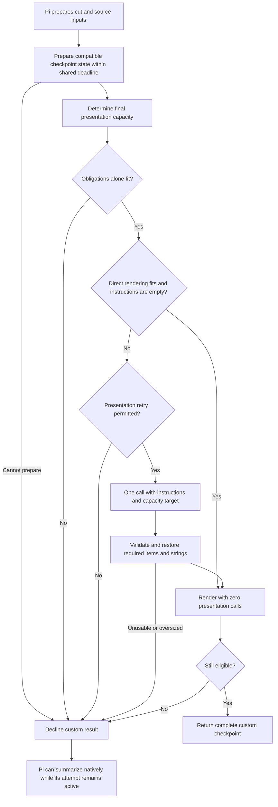
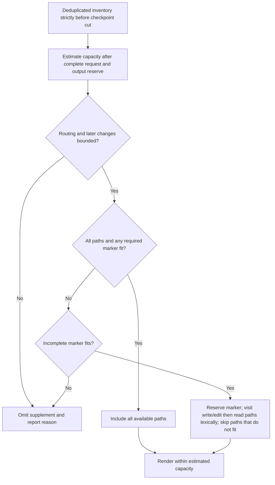

# Compaction

This area defines custom checkpoint preparation before Pi generates a native summary, and cumulative file information for later requests. It assumes the root contract, session-state rules, and recall access policy.

## Checkpoint preparation

### REQ-checkpoint-eligibility — Checkpoint eligibility

A custom checkpoint is eligible only when its lineage, state basis, source coverage, presentation, and capacity are valid for the current compaction attempt. Recheck those conditions before returning it.

**Intent:** Return a complete checkpoint for Pi's prepared cut rather than a partial account of available memory.

Eligibility requires all of the following:

- Records and dependencies belong to the selected lineage. Freshness compares lineage, source versions, and state basis, not elapsed time.
- Processing accounts for effective portions of `messagesToSummarize` and `turnPrefixMessages`, the applicable `previousSummary`, and edits or omissions to earlier covered sources. Accepted reduced tool-result processing counts as reduced coverage. Checkpoint-only catch-up counts only for that checkpoint. Derived baselines do not invent original-source coverage. Scheduled, partial, or failed work does not count.
- Checkpoint state satisfies the before-cut rule and supplies the required split-turn content.
- Presentation includes every applicable item, obligations verbatim, and protected strings in their corresponding items.
- The complete rendering fits its documented budget, including file information and format text within estimated available request capacity. Unknown or inadequately bounded capacity prevents eligibility.

For virtual acting models, capacity must bound the actual request or every route that an enforced routing policy permits. Advertised virtual limits, the last physical response, and a catalog snapshot alone do not establish that bound. When it cannot be established, decline and report the limitation through degradation reporting. An independently configured observer does not resolve acting-request capacity.

Structural inclusion is checkable; semantic completeness and justified retirement remain separate quality questions.

**Scenarios:**

- Leave one prepared portion unprocessed. **Expected:** The candidate stays ineligible until valid catch-up accounts for it.
- Change selected lineage after preparing a candidate. **Expected:** The final check rejects stale state.
- Supply valid coverage but omit required split-turn progress. **Expected:** Coverage alone does not establish eligibility.
- Prepare a checkpoint that exceeds available capacity after file and format text. **Expected:** It cannot be returned as eligible.
- Select a virtual acting model without a verifiable request or enforced all-route bound. **Expected:** Decline custom compaction and emit the degradation notice even when the advertised window appears large enough.

### REQ-checkpoint-presentation — Checkpoint presentation

Render a fitting eligible checkpoint without a presentation model call when instructions are empty. Otherwise, condensation and instructed presentation share at most one bounded model call per compaction attempt, separate from observer catch-up. That call receives the checkpoint state, Pi's prepared inputs, instructions, and final capacity target together, subject to snapshot-capacity retry suppression.

**Intent:** Apply presentation instructions and capacity limits without changing accepted memory or losing required items.

Condensation shortens maintained context; instructions can reorder, group, shorten maintained items, and add emphasis. Neither function removes applicable items or changes obligation text. Code renders obligations verbatim, turn-linked context, and file information. Output has machine-checkable correspondence to snapshot items; its internal schema remains an implementation choice.

When output omits an item or drops a protected string from shortened text, code restores that item's checkpoint-state text and reports the repair. State unapplied instruction parts in the checkpoint and report them to the user. Presentation does not change accepted state or initiate archive search.

**Failure behavior:** If obligations alone cannot fit, decline before presentation inference. If output is unusable or its repaired rendering exceeds capacity, decline without another presentation call. Record repaired overflow for retry suppression.

**Scenarios:**

- Supply a fitting checkpoint and empty instructions. **Expected:** Direct rendering makes zero presentation calls.
- Ask to emphasize a decision and remove an obligation. **Expected:** One call applies permitted emphasis; the obligation stays verbatim and the unapplied removal is stated and reported.
- Omit an item or its protected string from output. **Expected:** Code restores that item's original checkpoint-state text and reports the repair.
- Return a presentation whose repair overflows. **Expected:** Decline without another condensation or presentation call.
- Supply obligations that alone exceed capacity. **Expected:** Decline without presentation inference.

### REQ-unified-compaction — Unified compaction

Automatic, manual, SDK, and extension compactions that reach `session_before_compact` use the same bounded preparation path. Preserve Pi's automatic settings, prepared `firstKeptEntryId`, and incoming `willRetry` decision.

**Intent:** Use eligible prepared memory while preserving Pi's fallback and retry behavior.

Prepare compatible checkpoint state and missing semantic content through bounded same-observer catch-up, determine final capacity, then apply the presentation requirement. Return one complete eligible custom checkpoint. Otherwise **decline** by returning no custom result, permitting whole-checkpoint native fallback while the host attempt remains active. Never append a native summary of the same evidence to a custom checkpoint.

Catch-up and presentation share one foreground deadline, including waiting, inference, validation, and rechecking. Use the captured concrete observer configuration with Pi credential resolution, applicable personal endpoint checks, and cancellation. Missing helper credentials do not invalidate an already eligible direct rendering. Native summarization has separate host controls.

**Failure behavior:** Package failure does not cancel compaction to force fallback; cancellation can suppress the host's overflow retry. A helper timeout permits decline while the host attempt remains active. Host cancellation ends the attempt. Throwing is not a general fallback mechanism. Report package fallback reasons separately from the eventual host outcome.

**Note:** This diagram illustrates the preparation path. Host cancellation ends it at any stage.

**Scenarios:**

- Invoke each supported compaction entry path with the same prepared state. **Expected:** Each preserves Pi's cut and uses the same eligibility and preparation rules.
- Fail catch-up under each incoming retry value. **Expected:** Decline without package cancellation; Pi retains control of its retry decision.
- Time out a helper while the host signal is active. **Expected:** Decline and distinguish preparation failure from the later host result.
- Abort the host attempt. **Expected:** Preparation stops and does not claim native fallback succeeded.
- Supply an eligible direct rendering without helper credentials. **Expected:** The checkpoint can be returned without helper authentication.

### REQ-checkpoint-ownership — Checkpoint ownership

Determine checkpoint identity and ownership from selected stored state. Do not treat a success event's summary-text match or `fromHook` flag, which identifies an extension-produced checkpoint, as proof that the stored checkpoint is this package's candidate. Treat other writers' checkpoints as derived evidence.

**Intent:** Reconstruct the actual checkpoint after competing extension writes or host entry paths.

Single replacement ownership is an operating assumption, not host enforcement. Later handlers can replace a candidate. Handlers at turn end (`turn_end`) or before a run settles (`agent_before_settle`) can return checkpoint objects called boundary drafts. Pi can store them without the usual compaction hooks. Handle failure reporting without a preceding before-hook.

**Scenarios:**

- Store repeated identical summary text across branches. **Expected:** Ownership follows selected stored identity rather than the first text match.
- Replace a candidate in a later handler or store another extension's boundary draft. **Expected:** Its checkpoint supplies only derived evidence, not invented observer coverage.
- Receive failure before hook entry. **Expected:** Report the host outcome without requiring a matched preparation attempt.

## Cumulative file information

### REQ-file-inventory — File inventory

Record Pi `read`, `write`, and `edit` invocations with non-empty string paths, including direct assistant calls and recorded tool-result nested-call metadata. Include recognized failed invocations; an invocation is not proof of a successful filesystem effect. Exclude other tool names, arbitrary shell changes, and printed call-like text.

**Intent:** Preserve available cumulative file activity without claiming verified filesystem effects.

Include deterministic cumulative file information in custom checkpoints. Reconcile file-path sections inherited from prior checkpoints and deduplicate paths; write/edit classification takes precedence over read-only classification. The inventory includes only source invocations strictly before the checkpoint cut; later operations remain in recent history. Report unavailable or incomplete source inventory. Semantic snapshot items preserve task-critical paths independently of this supplementary list.

**Scenarios:**

- Supply direct and recorded nested calls with valid, empty, and non-string paths. **Expected:** Only recognized non-empty string paths enter inventory.
- Include failed `write`, shell operations, printed call text, and `custom_read`. **Expected:** The failed `write` enters inventory; the others do not.
- Put a file invocation at `firstKeptEntryId`. **Expected:** It remains in retained history and is excluded from the checkpoint inventory.
- Read and edit the same path strictly before the cut, then write another path after it. **Expected:** The first appears once as modified; the later path stays outside the checkpoint inventory.

### REQ-native-inventory-supplement — Native inventory supplement

While enabled, add a bounded file-inventory supplement to acting requests that use a native checkpoint. Estimate capacity after all other request content: native checkpoint, system context, active tool declarations, retained history and other messages, format text, and output reserve. Include the complete available inventory when it fits.

**Intent:** Restore useful cumulative path information to native-checkpoint requests within a defensible capacity estimate.

A virtual model routes a selection to a concrete model whose limits can differ. Use a documented estimator and conservative bounds for supported request transformations and routing. Prior provider usage, registered tool lists, and a virtual model's advertised window alone are insufficient. When later changes or routed limits cannot be bounded, omit the supplement and report the reason through degradation reporting and status. The estimate is not a guarantee of provider acceptance.

When full inventory does not fit, reserve an incomplete-inventory marker, then visit deduplicated write/edit paths lexically followed by read-only paths lexically. Include each whole path that fits; skip a non-fitting path and continue. Never truncate a path. Reserve the marker also when source inventory is incomplete. If even the marker cannot fit, omit the supplement and report why through degradation reporting and status.

Recompute selection when capacity changes. Identical inventory and capacity inputs produce identical output; capacity changes do not admit post-cut operations. Apply through public context transformation without changing stored checkpoint text, TUI rendering, or Pi's rules for inheriting file-operation metadata between checkpoints. Do not mutate undocumented preparation objects.

**Note:** This diagram illustrates capacity-based selection, not semantic retention of critical paths.

**Scenarios:**

- Alternate custom and native checkpoints with unchanged request capacity. **Expected:** Available earlier inventory appears once with deterministic output; stored native metadata remains unchanged.
- Put an oversized write path before shorter write and read paths that fit with the marker. **Expected:** Skip the long path, include fitting paths in priority order, and mark incompleteness.
- Increase the native checkpoint size or retained history, or switch to a smaller known model. **Expected:** Recompute a smaller subset without admitting post-cut paths.
- Leave routing unresolved or permit an unbounded later request mutation. **Expected:** Omit the supplement and report unknown capacity, rather than relying on previous usage.
- Supply incomplete source inventory when the marker cannot fit. **Expected:** Omit the supplement and report the capacity limit.
