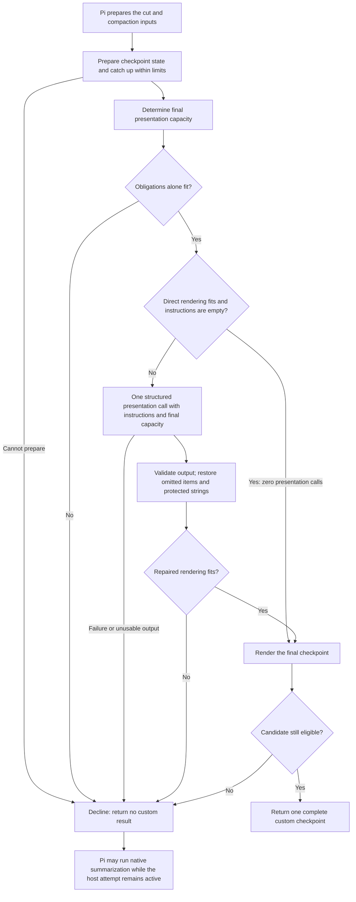
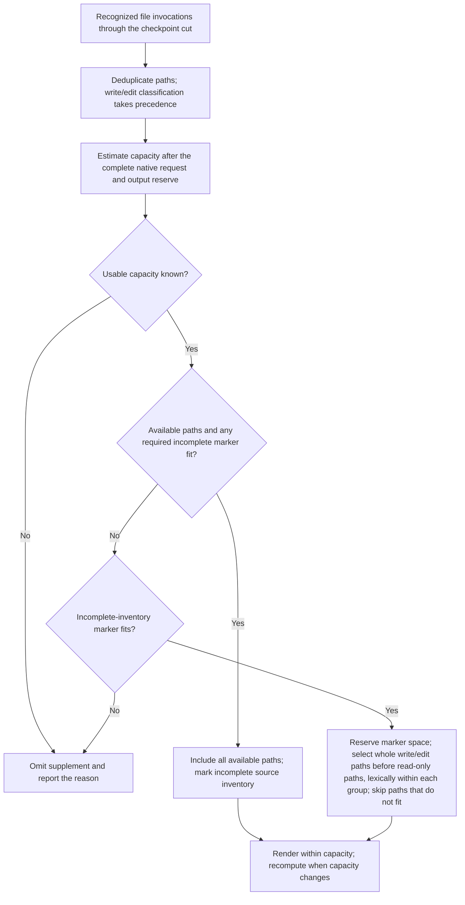

# Compaction

This area defines how memory supplies a custom checkpoint in place of Pi's native summary while preserving Pi's cut. It assumes the shared contract, session-state rules, and recall access policy. The procedure runs during compaction, before Pi generates a native summary, for automatic, manual, SDK, and extension calls that reach the before-compaction hook.

## Checkpoint preparation

### REQ-unified-compaction — Unified compaction

For every compaction attempt, the package preserves Pi's automatic settings and prepared `firstKeptEntryId`. Let Pi execute its incoming `willRetry` decision, which determines whether Pi retries the interrupted acting turn after overflow compaction. Package failure must not cancel compaction to force fallback, since cancellation can suppress that retry. Through `session_before_compact`, use the same bounded preparation pipeline for automatic, manual, SDK, and extension calls that reach the hook.

**Intent:** Use prepared memory when it is eligible and preserve the host fallback and retry behavior otherwise.

A candidate is **eligible** only when all these conditions hold:

- Its accepted records and dependencies are valid for the selected lineage. Freshness compares lineage, source versions, and state basis, not elapsed time.
- Processing accounts for all effective text portions in `messagesToSummarize` and `turnPrefixMessages`, plus the applicable `previousSummary`. It also accounts for every context edit, including an omission, to an earlier source that the checkpoint state covers. Accepted processing counts, including tool results reduced under the documented rule; checkpoint-only catch-up counts for that checkpoint. An accepted derived baseline can account for earlier history without inventing original-source coverage. Scheduled, partial, or failed processing does not count.
- Its source horizon and state basis satisfy the snapshot's before-cut rule. Later completion or cancellation in retained history has not been applied early.
- Presentation includes every applicable checkpoint-state item and the split-turn context, renders obligations verbatim, and keeps every protected string in its item's text. Structural inclusion is checkable; semantic completeness and justified retirement are separate quality questions.
- The complete rendered checkpoint fits its documented budget, accounting for deterministic file information and surrounding format text within the model request's available capacity.

Prepare the candidate in this order:

1. Where coverage is missing or the source horizon does not match the cut, perform bounded same-observer catch-up.
2. Determine the final presentation capacity, including deterministic file information and surrounding format text. If obligations alone cannot fit, decline. When direct rendering fits and the instruction string is empty, render without a presentation model call.
3. Otherwise, make one bounded structured presentation call using the checkpoint state, Pi's prepared inputs, the instructions, and the final capacity target together. Instructions can reorder, group, and shorten maintained items, and the framing note can add emphasis. They cannot remove applicable items or change obligation text. State unapplied instruction parts in the framing note and report them to the user.
4. Validate and render the output, restoring omitted items and protected strings under the snapshot rule. If the repaired result cannot fit, decline without a further presentation call, including when instructions caused the expansion.

Instructed presentation and condensation do not change accepted state or initiate archive search.

Recheck eligibility before returning one complete custom checkpoint for Pi to store in place of a native summary. If it remains ineligible, **decline** by returning no custom compaction result, permitting whole-checkpoint native fallback while the host attempt remains active. Never append a native summary of the same evidence to a custom checkpoint. Report fallback reasons separately from the eventual host outcome.

Catch-up, condensation, and instructed presentation share one foreground deadline, including waiting, inference, validation, and rechecking. Use the resolved observer model policy with explicit routing, credential resolution, and cancellation handling. Native summarization has separate host controls. Missing helper credentials need not invalidate an already eligible candidate. A helper timeout can permit decline; host cancellation ends the attempt. Throwing is not a general fallback mechanism.

Single checkpoint ownership is an operating assumption. Later handlers can replace a candidate. `turn_end` and `agent_before_settle` handlers can return compaction drafts that Pi stores directly, bypassing the usual compaction hooks. The success event finds the first matching summary text across all stored branches, so identical text can identify an older checkpoint. Check selected stored identity and ownership rather than relying on that match or Pi's `fromHook` flag, which marks extension-produced checkpoints. Treat other writers' checkpoints as derived evidence. Handle failure reporting without a preceding before-hook.

**Note:** This diagram illustrates the preparation decision. Host cancellation ends the attempt at any stage; the shared deadline also includes waiting, validation, and rechecking.

**Scenarios:**

- Supply a complete eligible checkpoint that fits, empty instructions, and available helper credentials. **Expected:** Return the complete custom checkpoint with zero presentation model calls.
- Leave one prepared text portion or previous summary unprocessed; exercise both retry values, helper timeout, missing credentials, and host abort. **Expected:** A gap prevents eligibility until catch-up processes it; failed preparation declines without package cancellation; host abort ends the attempt; eligible rendering needs no helper credentials.
- Omit a covered source that a snapshot item cites, then compact before the next observer job. **Expected:** Catch-up processes the omission before the candidate is eligible, or the attempt falls back; the checkpoint does not present the item without that processing.
- Use repeated identical summaries, a later replacement handler, a draft returned by `turn_end` or `agent_before_settle`, and failure before hook entry. **Expected:** Ownership follows selected stored state; foreign checkpoints supply only derived evidence; failure reporting does not depend on a matched before-hook.
- Supply an eligible prepared candidate and a non-empty instruction that requests a presentation change and an obligation's removal. **Expected:** Instructed presentation runs before return; the obligation stays verbatim; the framing note states the unapplied removal and the user receives a report; an unusable candidate triggers reported fallback.
- Supply instructions that expand a fitting checkpoint, then return an oversized or incomplete structured presentation whose repair overflows. **Expected:** Instructions and the final capacity target reach one presentation call; code restores required items and strings; overflow declines without another presentation or condensation call.

## Cumulative file information

### REQ-file-inventory — File inventory

A file inventory records invocations of Pi's `read`, `write`, and `edit` tools with non-empty string paths. Recognize direct assistant tool calls and calls recorded in tool-result nested-call metadata. An invocation is not proof of a successful filesystem effect; include recognized failed invocations. Exclude arbitrary shell changes and printed call-like text.

**Intent:** Preserve available cumulative file activity within request capacity without claiming verified filesystem effects.

Include deterministic cumulative file information in custom checkpoint text. While enabled, add a bounded file-inventory supplement to acting-model requests that use a native checkpoint. Reconcile repeated file blocks and deduplicate paths. A write/edit target does not also appear as read-only. Source inventory remains fixed to the checkpoint cut; later operations remain in recent history.

For a native-checkpoint supplement, estimate available capacity in the acting-model request after accounting for all its other content: the existing native checkpoint, system context, tools, retained history and other messages, surrounding format text, and output reserve. Include the complete available inventory when it fits. Otherwise select whole paths within that capacity, prioritizing write/edit targets before read-only paths and using lexical order within each group. Visit paths in that order, include each whole path that fits the remaining capacity, and skip a non-fitting path while continuing through the rest. A read-only path may fit even when a longer write/edit path was omitted. Never truncate a path. When source inventory is incomplete or selection omits paths, reserve space for an explicit incomplete-inventory marker. If capacity cannot be estimated sufficiently, or even that marker cannot fit, omit the supplement and report the reason through status. Report unavailable or incomplete inventory.

Recompute the fitting subset when capacity changes, including a smaller model or growing retained history. Identical inventory and capacity inputs produce identical output. Capacity-based selection does not admit post-cut operations or remove task-critical paths from the semantic snapshot.

Apply the supplement through public context transformation. It does not change the stored checkpoint, its TUI rendering, or Pi's copying of file-list metadata from earlier checkpoints. Do not mutate undocumented preparation objects.

**Note:** This diagram illustrates selection for a native-checkpoint supplement. Task-critical paths remain protected in semantic snapshot items independently of this supplementary list.

**Scenarios:**

- Alternate custom/native checkpoints and repeat requests with unchanged capacity, with file invocations on both sides of the cut. **Expected:** Available earlier inventory appears once with deterministic output; later invocations remain in recent history; incomplete inventory is reported without claiming stored-metadata repair.
- Supply direct and recorded nested read/write/edit calls with valid, empty, and non-string paths; include failures, shell operations, printed call-like text, and direct and nested `custom_read` calls with valid paths. **Expected:** Differently named tools remain excluded; only recognized calls with non-empty string paths enter inventory, including failed invocations; inventory does not claim successful effects.
- Supply a full inventory that fits, then limit capacity with repeated read/write paths, long paths, a smaller model, and growing retained history. **Expected:** Full inventory appears when it fits; partial selection keeps whole paths, deduplicates, prioritizes write/edit targets, sorts lexically within groups, and reserves an incomplete marker. Changed capacity recomputes selection without admitting post-cut activity.
- Place an oversized write path first lexically, followed by a shorter write path and a shorter read-only path; reserve enough capacity for both shorter paths and the incomplete marker. **Expected:** Skip the oversized path, include both shorter paths in priority order, and mark the inventory incomplete.
- Keep inventory and retained history unchanged while increasing the existing native checkpoint size. **Expected:** Supplement capacity shrinks with the complete request; selection becomes partial or is omitted with the required report when it cannot fit.
- Supply incomplete source inventory, an unknown usable capacity, and capacity too small for the incomplete marker. **Expected:** Incomplete output is marked when it fits; otherwise the supplement is omitted with a status reason. Capacity accounting includes the existing native checkpoint and every other request component, including system context, tools, messages, surrounding format text, and output reserve.
