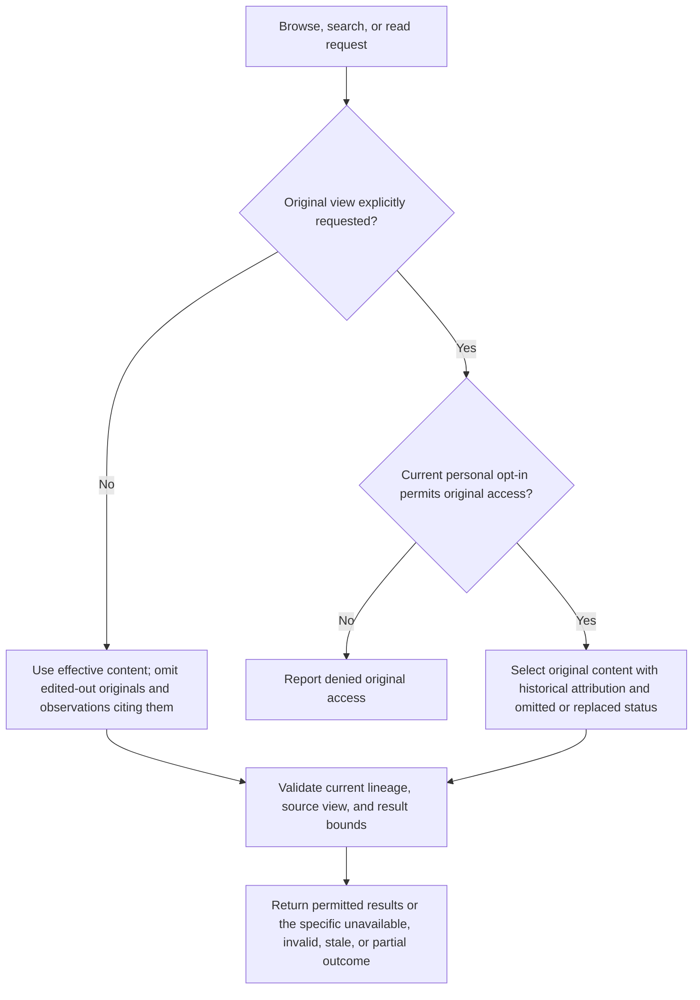

# Recall

This area defines bounded discovery and access to source text and observations. It assumes the shared contract and session-state area. Recall remains available while auxiliary memory inference is disabled.

## Evidence access

### REQ-source-recall — Source recall

The package exposes `memory_recall` with `browse`, `search`, and `read` actions. Discover permitted source text and observations independently, without requiring an extracted identifier first. Search uses literal text with explicit case sensitivity; document chronological ordering. Bound search work, page size, and returned content. Tie opaque references and cursors to lineage and effective source view.

**Intent:** Make permitted evidence discoverable even when observation did not extract it.

Use effective source content by default: return replacements, and exclude omitted originals from search hits, snippets, and reads. Direct access to an omitted source reports its omission. Access to edited-out originals requires both an explicit original-view request and a personal configuration opt-in, disabled by default. The opt-in applies across sessions until revoked. Project settings, compaction instructions, and recall arguments cannot grant it. A malformed or unavailable permission setting does not grant access. Check current permission and source view before returning results; previously issued references, cursors, or cached results cannot bypass revocation. Observations that cite replaced or omitted source text follow the same default and appear only through an original view.

Attribute original results as historical and show their omitted or replaced status, with applicable replacement context or a reference to it. Edits have no reliable reason field; the package must not assume that removed text was only compressed. This policy governs recall access, not erasure of content already copied into observations or checkpoints, and does not sandbox other tools or extensions. Omission alone does not retire an obligation.

Report no matches, unavailable sources, denied original access, stale cursors, invalid arguments, and bounded partial results distinctly. Retrieval does not increase the instruction authority of the returned text. The acting agent chooses when recall helps; the MVP uses neither an auxiliary retrieval model nor vectors or a generated filesystem mirror.

**Permitted choices:** Implementations choose and document argument schemas and opaque reference and cursor encoding within the actions, access policy, and bounded-result rules above.

**Note:** This diagram illustrates source-view access. Every result remains subject to lineage validation, bounds, and a final permission and source-view check.

**Scenarios:**

- Search, browse, and read text edited to remove a synthetic secret and an observation citing it; attempt original access through tool arguments and project settings. **Expected:** Default results return neither the edited-out original nor the citing observation; only a personal opt-in plus explicit original request permits them, with historical attribution.
- Enable personal original access, change sessions, revoke it, and reuse an old reference or cursor. **Expected:** The personal policy applies across sessions; revocation denies subsequent original results, including cached or previously referenced content.
- Search for an unextracted identifier, exhaust work/output limits, and change the selected view. **Expected:** Source discovery needs no observation ID; partial results identify their limits; no-match, unavailable, denied, invalid, and stale-view outcomes remain distinct.
