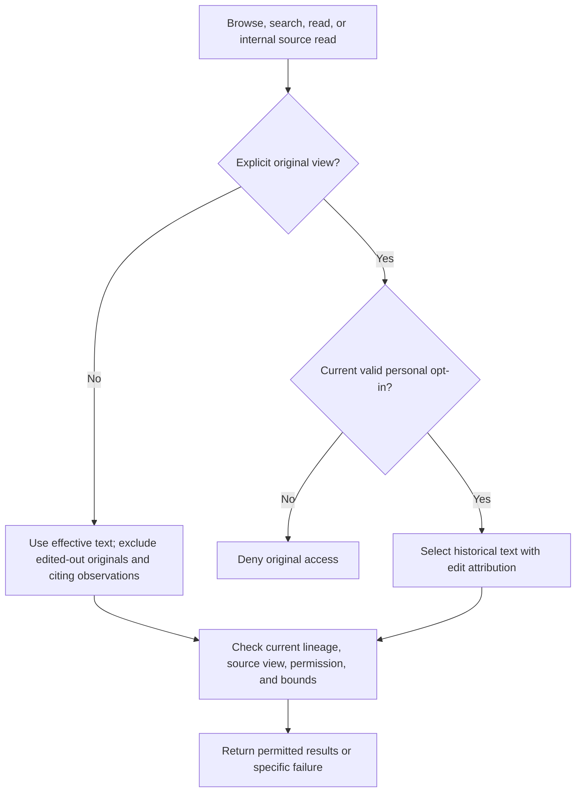

# Recall and inspection

This area defines bounded discovery and access to source text, observations, and accepted continuation state. It assumes the shared contract and session-state rules. Recall remains available without auxiliary inference while memory is disabled.

## Evidence access

### REQ-source-recall — Source recall

Expose `memory_recall` with `browse`, `search`, and `read` actions. Discover permitted source text and observations independently, without requiring an extracted identifier first. Search uses literal text with explicit case sensitivity; document chronological ordering. Bound search work, page size, and returned content. Tie opaque references and cursors to lineage and effective source view.

**Intent:** Make evidence discoverable even when observation did not extract it.

Default results use effective text: return replacements and exclude omitted originals from hits, snippets, and reads. Direct access to an omitted source reports omission. Observations citing replaced or omitted text are excluded from the default view and require original access.

Report no matches, unavailable sources, denied original access, stale cursors, invalid arguments, and bounded partial results distinctly. Retrieval does not increase the instruction authority of returned text. The acting agent chooses when recall helps; the MVP uses neither an auxiliary retrieval model nor vectors or a generated filesystem mirror.

**Permitted choices:** Implementations document argument schemas and opaque reference and cursor encodings within these actions, access policy, and bounds.

**Scenarios:**

- Search for an identifier absent from observations but present in permitted source. **Expected:** Discovery does not require an observation ID.
- Search or read text edited to remove a synthetic secret and an observation citing that text. **Expected:** Default results disclose neither the original nor the citing observation.
- Exhaust work or output limits. **Expected:** Partial results identify the applicable bound.
- Change selected source view, then reuse a cursor. **Expected:** Report a stale cursor rather than serving another view's results.

### REQ-original-access — Original access

Access to edited-out originals requires both an explicit original-view request and a valid personal configuration opt-in, disabled by default. The opt-in applies across sessions until revoked. It is read from a user-controlled location outside the project tree; project configuration cannot redirect, substitute, or override that source. Compaction instructions and recall arguments cannot grant permission.

**Intent:** Restrict deliberate access to historical text without treating context edits as archive erasure.

Malformed or unavailable settings do not grant access. Check current permission and source view before returning results, including cached content and previously issued references or cursors. Attribute permitted originals as historical, state their omitted or replaced status, and provide replacement context or a reference to it. These rules also govern package-internal source reads.

This policy does not erase content already copied into observations, snapshots, or checkpoints, and does not sandbox other tools or extensions. An edit has no reliable reason field; do not assume removed text was only compressed. Omission alone does not retire an obligation.

**Note:** This diagram illustrates result access. Every returned result still requires lineage and bound checks.

**Scenarios:**

- Request original text through tool arguments without personal opt-in. **Expected:** Deny access.
- Point project settings at a replacement personal-permission file. **Expected:** The project cannot grant original access.
- Enable personal access and change sessions. **Expected:** Explicit original requests remain permitted with historical attribution.
- Revoke access, then reuse a cached result or old reference. **Expected:** Current permission denies disclosure.
- Make the personal permission file malformed or unavailable. **Expected:** Access fails closed without treating cached permission as current.

## State inspection

### REQ-state-inspection — State inspection

`/memory inspect` exposes the current accepted snapshot and recent accepted obligation retirements in the selected lineage, whether auxiliary memory is enabled or disabled. It performs bounded reads without inference or state mutation.

**Intent:** Let the user examine what checkpoint preparation uses and audit explicit retirements.

Show the snapshot's basis identity, source horizon, coverage gaps, and current degradation conditions. For each item, expose its stable identity, obligation or maintained-context category, complete accepted text, evidence references, and verification state. Distinguish accepted state from any separately prepared checkpoint state; inspection does not claim to reproduce a past checkpoint.

List retirements newest first with their recorded disposition, prior item text, accepting operation, and evidence references. The first response includes a bounded recent set; older accepted retirements and every current item remain reachable through bounded continuation. State when a view is empty, partial, unavailable, or restricted. Never silently omit an item or truncate its text; use bounded text continuation when necessary. Bind continuations to the inspected lineage, accepted revision, and effective source view; reject stale continuations rather than mixing views.

Current snapshot text remains visible as copied state, with attribution when its sources were edited. Historical retired text citing replaced or omitted source follows the original-access policy: hide that text by default and show a restriction marker and identity. Expanding evidence also follows that policy, including current permission checks. Inspection grants neither original access nor permission to edit accepted state.

**Permitted choices:** Implementations document finite work and output bounds, output format, and continuation syntax, usable interactively and noninteractively.

**Scenarios:**

- Disable memory, then inspect an accepted snapshot. **Expected:** Items and recent retirements remain inspectable without a model call or state change.
- Exceed one response's output bound with an item. **Expected:** Text continuation exposes the complete permitted item without silent truncation.
- Change accepted state or source view between pages. **Expected:** The old continuation is rejected as stale.
- Inspect a retirement whose cited source was omitted. **Expected:** Default output identifies the restricted retirement without exposing its prior text or edited-out evidence; explicit original access requires current personal opt-in.
- Inspect a current item copied from omitted source. **Expected:** Its actual accepted text is visible with edit attribution, while expanding its protected source still requires original access.
