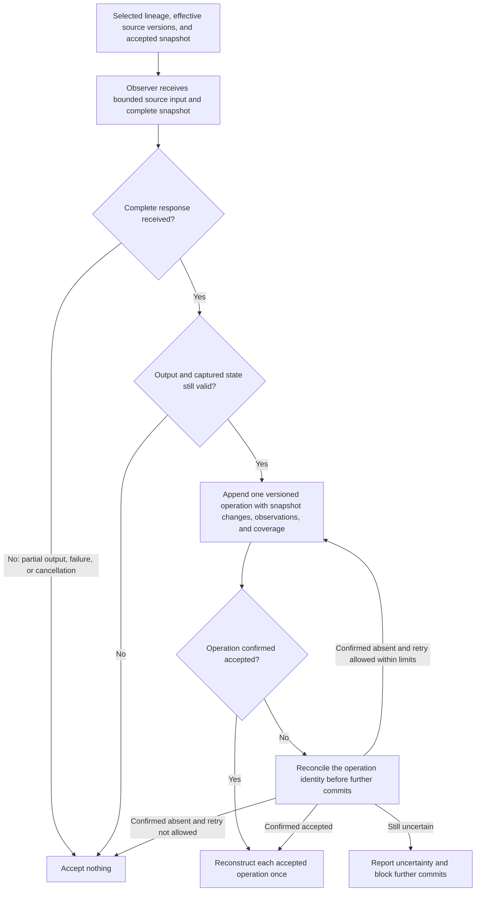
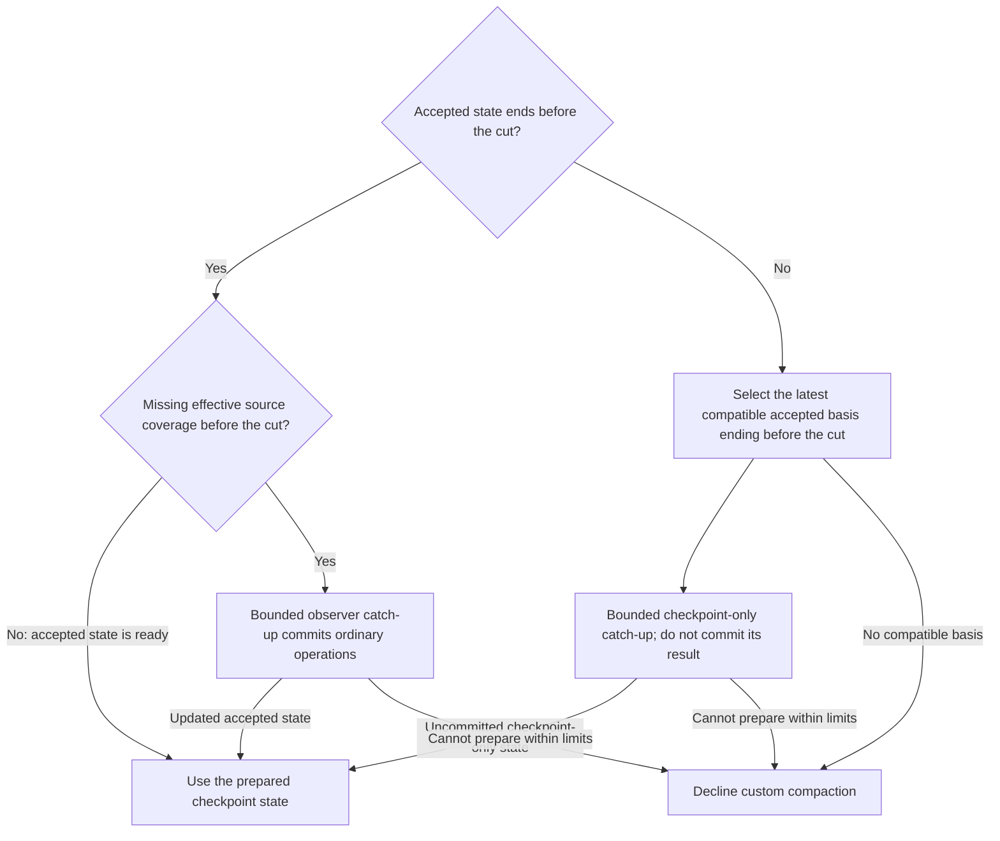

# Session state

This area defines the memory state reconstructed from the selected lineage, the user's activation controls, and accepted updates. It assumes the shared terms and invariants in the root specification.

## Lineage and reconstruction

### REQ-session-lineage — Session lineage

Pi custom session entries are authoritative and follow Pi retention. Reconstruct accepted state on resume; indexes may be rebuilt. Validate selected ancestry as well as identity, since forks can copy entry IDs into a different session. Reject pending results whose lineage, effective source, or accepted-state basis became stale. Forks inherit accepted records in their ancestry, not later observer commits for earlier sources; missing processing needs catch-up.

**Intent:** Reconstruct only memory that belongs to the selected ancestry and valid dependencies.

The applicable prepared `previousSummary` may establish an attributed derived baseline without replaying the entire archive. Its position follows Pi's projected history, the selected conversation after compaction and context edits, and the represented source horizon, not its later append position; the next cut may still lie inside its retained tail. A branch summary may likewise supply earlier derived evidence within the prepared source view. Preserve applicable accepted obligations and track original-source coverage separately. Resolve known invalidations or missing facts from available evidence when needed; a summary cannot silently repair them or authorize otherwise denied original access.

Malformed, unsupported, or inconsistent memory records stop reconstruction at the last validated state whose dependencies remain valid. Do not accept descendants of an invalid dependency. Report degradation and use native compaction until eligibility can be established again. Recall remains available where provenance and access policy permit. Pi append can change memory before persistence fails, and ephemeral or unflushed sessions can lose records. Do not promise transactional rollback or crash durability.

**Scenarios:**

- Resume, fork before an observer commit, navigate, or context-edit a source during pending work. **Expected:** Only selected-ancestry records reconstruct; copied IDs do not admit foreign state; stale work is rejected; missing pre-fork processing requires catch-up.
- Introduce an invalid dependency and an external derived baseline. **Expected:** Reconstruction stops at valid dependencies; recovery does not invent original coverage or bypass known invalidations.
- Compact twice with the second cut inside the first checkpoint's retained tail. **Expected:** The applicable prepared previous summary remains an admissible derived baseline despite its later append position; original-source coverage remains separate.

## Activation and configuration

### REQ-memory-activation — Memory activation

Package loading alone does not enable auxiliary inference. `/memory on` enables it; new sessions default to disabled. Persist enablement and the selected observer model with the lineage. Forks inherit those records in their ancestry. Unless settings specify a model, select the acting model at activation. Keep each job's captured configuration fixed for that job and make explicit configuration changes visible.

**Intent:** Give the user explicit control over auxiliary inference while keeping bounded recall available.

Disablement cancels package work, prevents late commits, stops custom checkpoint production, and removes request-local file supplements. It does not erase stored checkpoints or memory. Keep recall registered and usable while disabled under its normal bounds and access policy, without auxiliary inference. Native compaction remains available. Re-enablement reconstructs eligible lineage state and handles missing coverage before supplying a custom checkpoint.

Provide status, disablement, and configuration inspection through commands usable interactively and noninteractively, with validated file-based settings. Status reports the effective model, coverage, pending work, capacity degradation, fallback reasons, and original-access policy. No settings dialog or per-update approval interface is required.

**Permitted choices:** Implementations choose and document remaining command spelling, settings locations, reload triggers, and settings precedence. These choices preserve the personal-only original-access policy and do not change the lineage's selected model implicitly.

**Scenarios:**

- Load disabled, enable and resume, change settings, then disable with a job and eligible snapshot pending. **Expected:** Disabled operation performs no observation, custom checkpoint, or supplement; late work cannot commit; recall remains usable; enabled jobs use pinned configuration and inherited ancestry state.

## Observation acceptance

### REQ-session-observations — Session observations

One observer response proposes snapshot changes and observations. Each job receives the complete snapshot of its accepted-state basis, including every active obligation and maintained item, and bounded effective-text inputs. Input scope follows Pi's text compaction scope, including assistant thinking and tool arguments, tool-result text, included custom messages, and derived checkpoint or branch-summary text. Images remain original evidence under Pi retention; text processing must not claim image coverage. Arbitrary extension state is not conversation input.

**Intent:** Accept traceable updates only after complete validation of the source view and state basis.

References identify the source session, entry, content portion, and effective version or edit. Process oversized text in bounded portions without claiming coverage of unprocessed content. A tool result above a documented size may instead be processed as a fixed excerpt from its start and end. Coverage records that result as reduced, never as fully processed, and recall keeps its full text. Other text is not reduced. Observing a summary establishes coverage of that derived text, not its originals. Preserve evidence identity, attribution, scope, and verification state when the package reads bounded source content internally to prepare observer inputs or validate proposals. Session observations do not automatically become general project facts or developer preferences.

A context edit to a source with accepted coverage makes that source uncovered; it does not invalidate accepted records or roll state back. Process the source's effective version, or its omission, as new evidence against the current snapshot. That update can amend or remove items that cite the replaced text. Attribute replacement content as edited evidence; preserved message role does not establish its author or grant the replacement that role's instruction authority. Do not invent an editor identity.

A change that permits an additional action needs independent support from a separate, applicable instruction by the appropriate authority. This includes new or expanded permissions, weaker constraints, and removal of action prerequisites. The supporting instruction may precede or follow the edit, subject to the selected lineage and checkpoint's source horizon. Previously accepted state may preserve independently established permission. Repetition of an edited assertion in a summary is not independent support. Checking support must respect source-access restrictions; it does not authorize reading protected originals.

Ordinary factual corrections and task-status updates may use attributed edited evidence under the existing verification rules. A completion claim does not establish verified completion. Automatic updates remain available without per-change approval; the permission rule applies when an update would permit additional actions.

Accept a complete validated response as one logical operation: snapshot changes, observations, coverage, and an operation identity in one versioned Pi custom entry. The identity distinguishes one update and its retries from separate updates. A valid response with no changes may advance coverage. Invalid or partial output applies nothing. Additions require fresh identities and valid resulting content. Replacements and removals require existing targets in the supplied snapshot. Reject invalid references and changes outside that supplied basis. Reuse operation identity for uncertain retries, reconcile an ambiguous append before further commits, and apply each accepted operation once during reconstruction. Scheduling or receiving a partial response is not acceptance.

**Permitted choices:** Implementations choose and document record schemas, source-reference encoding, scheduling, the tool-result reduction threshold, and excerpt sizes. These choices preserve the accepted-state and source-coverage rules.

**Note:** Smaller observer jobs that end at points where Pi can cut, which never fall between a tool call and its results, can reduce checkpoint-only catch-up. This scheduling recommendation is informative.

**Note:** This diagram illustrates acceptance and rejection. The requirement text defines validity, atomic acceptance, and recovery from an uncertain append.

**Scenarios:**

- Process edited text, a derived summary, image-bearing records, and a tool result above the reduction size. **Expected:** Coverage names only accepted effective text portions and marks the tool result reduced; it does not claim images, unprocessed portions, or summary originals; recall can read the full tool result within its bounds.
- Add an item to empty state; return empty, partial, malformed, unknown replacement/removal, and retried updates; make an append outcome uncertain. **Expected:** A valid fresh addition is accepted; valid empty output may advance coverage; rejected output changes nothing; retry reconciliation applies one logical update once.
- After its coverage is accepted, context-edit a source whose text an item cites. **Expected:** The source becomes uncovered without rolling back accepted state; the next job processes its effective version against the complete snapshot and can amend or remove the citing item.
- Replace user-role text with a new permission, weaker constraint, or removed action prerequisite; repeat the assertion in a derived summary. **Expected:** The replacement remains attributed edited evidence without an invented editor; preserved role and repetition do not supply independent permission.
- Supply an independent applicable instruction before or after an edit, then repeat with independently supported permission in accepted state. **Expected:** Permission can retain its independently established scope; lineage and source-horizon rules still apply, including exclusion of support that lies after the cut.
- Edit an ordinary task fact or completion claim; attempt to inspect a protected original to establish permission. **Expected:** Attributed corrections can update state automatically; a completion claim alone is not verified completion; checking support does not bypass original-access restrictions.

## Snapshot maintenance and checkpoint state

### REQ-continuation-snapshot — Continuation snapshot

The observer returns structured additions, replacements, and removals addressing stable item identities. Additions and replacements supply the resulting content; code validates and applies operations without another model interpreting prose instructions. Updates are automatic and do not require per-change user approval. Omitted items persist.

**Intent:** Maintain current continuation state and present the state that applies before the prepared cut.

Accepted obligations change only through explicit evidence-linked additions, amendments, completion, cancellation, or supersession. Omission and age preserve them. Natural-language cancellation and supersession in source evidence can support retirement without a special user command. Every update reviews the active set; valid references establish traceability, not correct interpretation.

Maintain completed work, decisions and rationale, critical context, and identifiers through the same structured update mechanism. The observer may explicitly remove details no longer needed for continuation, while preserving applicable critical facts. Removal does not erase historical records from recall. A narrated removal rationale is not mandatory for ordinary context. Checkpoints render resulting continuation state, not operation logs or deletion explanations.

Present snapshots through checkpoints without routinely injecting background revisions into ordinary requests. A checkpoint represents semantic state before the cut under the effective source view at preparation. Its evidence and state dependencies must exclude later retained-history events. Applicable context edits still affect earlier sources even when those edits were recorded after the cut. Observer append position alone cannot select the correct state.

When accepted state ends before the cut, catch-up through the cut commits ordinary operations. When accepted state extends past the cut, start from a compatible earlier basis: the latest accepted state whose source horizon, including the state it builds on, ends before the cut. Bounded same-observer catch-up then processes the effective text between that horizon and the cut. This checkpoint-only result is validated within the compaction attempt and never committed to accepted state; the checkpoint's details record its basis and processed portions. In both cases, catch-up also processes context edits, including omissions, to earlier sources that the checkpoint state covers. Do not split a semantic update by filtering its citations. If compatible state cannot be prepared within limits, use native fallback.

**Condensation** shortens a presentation that exceeds capacity, and **instructed presentation** applies supplied compaction instructions; [unified compaction](compaction.md#req-unified-compaction--unified-compaction) defines when each runs. Both use at most one presentation model call per compaction attempt, separate from observer catch-up. That call receives both the instructions and final capacity target, whether one or both presentation functions are needed. Its structured output has:

- An order and grouping of item identities.
- Optional shorter text for maintained items, keyed by identity.
- An optional short framing note.
- The instruction parts that could not be applied.

Code renders obligations verbatim and renders split-turn context and file information itself. When the output omits an applicable item, or shortened text drops a protected string, code renders that item's checkpoint-state text and reports the repair. If obligations alone cannot fit, or the repaired presentation still exceeds capacity, report native fallback without another presentation or condensation call. Do not repeat an identical failed condensation until a relevant input changes: checkpoint state, evidence, instructions, configuration, or available capacity.

Observation can shrink the snapshot through supported retirement and removal while the snapshot fits the observer input budget. If the complete snapshot cannot fit that budget, suspend observation and report the need for an admissible model, budget, or lineage. Presentation condensation cannot repair that input limit.

**Note:** This diagram illustrates how the source horizon determines checkpoint state. Catch-up also processes applicable edits to earlier covered sources. The final compaction checks are defined in the compaction area.

**Scenarios:**

- Omit a decision and obligation; then explicitly remove obsolete context and supply supported obligation retirement. **Expected:** Omission preserves both items; valid explicit operations change only their targets automatically; checkpoint text excludes the operation log.
- Accept a batch spanning the cut and a delayed batch about earlier sources; compact while a completion remains in retained history. **Expected:** The checkpoint starts from the latest basis that ends before the cut plus uncommitted catch-up; its details record that basis; accepted state is unchanged afterward; the retained completion is not applied early; unrepairable preparation falls back.
- Exceed presentation capacity with maintained items, then with obligations alone; exceed the observer input budget with the complete snapshot; repeat unchanged failed preparation. **Expected:** Condensation shortens only maintained items and keeps obligations and protected strings verbatim; obligations that cannot fit fall back; an identical failed condensation is not repeated; an oversized snapshot suspends observation with a capacity report.
- Return a structured presentation that omits an applicable item identity or drops a protected string from shortened text. **Expected:** Code renders those items from checkpoint-state text and reports the repair; the candidate falls back only if the repaired presentation exceeds capacity.
