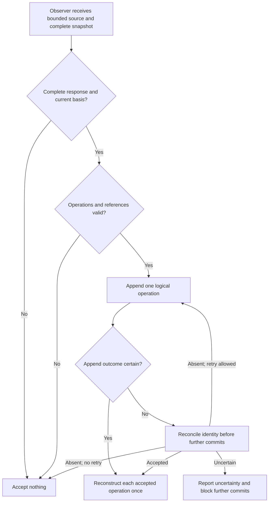
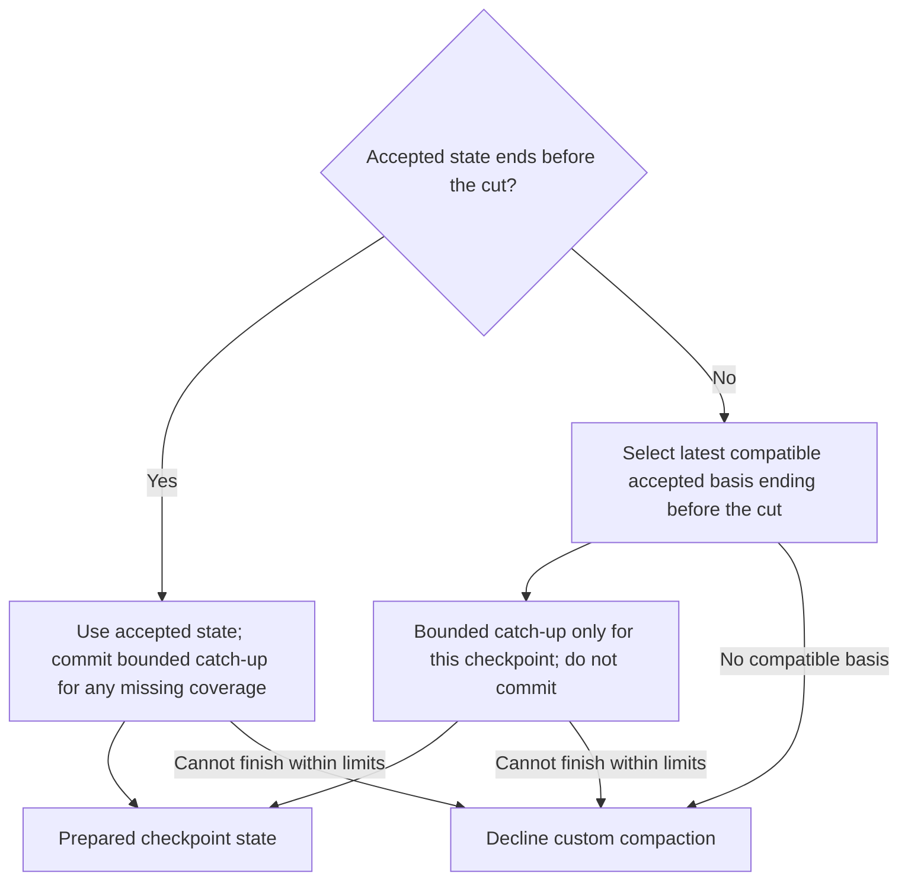

# Session state

This area defines lineage reconstruction, activation, accepted observation updates, and continuation snapshots. It assumes the root specification's terms and invariants. Compaction selects and renders these records without changing their authority.

## Lineage and reconstruction

### REQ-session-lineage — Session lineage

Pi custom session entries are authoritative and follow Pi retention. Reconstruct accepted state on resume; indexes may be rebuilt. Validate selected ancestry as well as identity, since forks can copy entry IDs into a different session. Reject pending results whose lineage, effective source, or accepted-state basis became stale. Forks inherit accepted records in their ancestry, not later observer commits for earlier sources.

**Intent:** Reconstruct only state valid for the selected ancestry and dependencies.

**Failure behavior:** Malformed, unsupported, or inconsistent records stop reconstruction at the last validated state whose dependencies remain valid. Reject descendants of an invalid dependency. Report degradation and use native compaction until eligibility is restored; recall remains available where provenance and access policy permit. Pi can append an entry in memory before its disk write fails. Ephemeral or unflushed sessions can lose records; the package does not promise transactional rollback or crash durability.

**Scenarios:**

- Fork before an observer commit about an earlier source. **Expected:** The fork excludes that commit and needs catch-up for the missing processing.
- Resume a fork with copied source IDs. **Expected:** Matching IDs do not admit records outside its ancestry.
- Navigate or context-edit source during a pending job. **Expected:** The stale result cannot commit.
- Reconstruct a record with an invalid dependency. **Expected:** Reconstruction stops before it and its descendants, reports degradation, and preserves permitted recall.

### REQ-derived-baseline — Derived baseline

The applicable prepared `previousSummary` can establish an attributed derived baseline without replaying the archive. Its position follows Pi's projected history—the selected conversation after compaction and context edits—and represented source horizon, not its append position. A selected branch summary can likewise supply derived evidence.

**Intent:** Continue from available summaries without inventing processing of their originals.

Preserve applicable accepted obligations and track original-source coverage separately. Resolve known invalidations or missing facts from permitted evidence when needed. A summary cannot silently repair them or authorize denied original access.

**Scenarios:**

- Compact twice with the second cut inside the first checkpoint's retained tail. **Expected:** The applicable previous summary remains admissible despite its later append position.
- Process an external checkpoint. **Expected:** Coverage describes derived text, not its original archive.
- Supply a summary that repeats an invalidated fact. **Expected:** Its repetition does not repair the invalidation or bypass source access policy.

## Activation and configuration

### REQ-memory-activation — Memory activation

Package loading alone does not enable auxiliary inference. `/memory on` enables it; new sessions default to disabled. Persist enablement in the lineage; forks inherit those records in their ancestry. Re-enablement reconstructs valid state and handles missing coverage before custom compaction.

**Intent:** Give the user explicit control over auxiliary inference while keeping bounded recall available.

Disablement:

- Cancels package work and prevents late commits.
- Stops custom checkpoint production.
- Removes request-local file supplements.

Disablement does not erase stored checkpoints or memory. Recall remains registered and usable under its normal policy without auxiliary inference. Native compaction remains available.

Provide status, disablement, and configuration inspection through commands usable interactively and noninteractively. Status reports the effective model and destination, coverage, pending work, capacity degradation, fallback reasons, and original-access policy. No settings dialog or per-update approval interface is required.

**Permitted choices:** Implementations document remaining command spelling. Commands that print status or perform an action need no interactive view.

**Scenarios:**

- Load a new session. **Expected:** Observation, custom checkpoints, and file supplements are disabled; recall works without auxiliary inference.
- Enable memory, resume, then fork after enablement. **Expected:** Selected-ancestry enablement persists.
- Disable while a job is pending. **Expected:** It is cancelled and cannot commit late; request supplements disappear and native compaction remains available.
- Re-enable after unprocessed conversation. **Expected:** Missing coverage is handled before returning a custom checkpoint.

### REQ-observer-configuration — Observer configuration

Unless personal configuration selects another observer model, capture the acting model at activation. Persist that selection with the lineage. Ordinary settings reloads and acting-model switches do not change it implicitly. Explicit observer configuration changes are visible through status and apply to newly scheduled jobs; each job's captured configuration stays fixed.

**Intent:** Keep auxiliary inference destinations explicit and prevent project configuration from redirecting session content.

Observer provider, account, and endpoint overrides come only from personal configuration outside the project tree. Project settings cannot supply or redirect those overrides. Resolve the default acting-model selection through Pi's current permitted model configuration. Check project trust through Pi's effective trust result, which includes temporary user choices and command-line overrides rather than only saved trust decisions. Before dispatch, revalidate the captured model's current routing, intended account, destination, and permission. A stored selection does not authorize a changed destination. On a mismatch or unavailable authority, reject queued dispatch and report the configuration problem; never silently route elsewhere. Credentials do not enter prompts, memory entries, or diagnostics.

**Permitted choices:** Implementations document validated file-based settings, locations, reload triggers, and precedence. Any supported project settings require Pi's current effective project trust and cannot override personal-only fields.

**Scenarios:**

- Enable with no observer override, then switch the acting model. **Expected:** The observer keeps its captured selection until an explicit change.
- Supply an observer endpoint in project settings. **Expected:** It cannot redirect observer data, even in a trusted project.
- Change an account, endpoint, or routing authority while a job waits. **Expected:** Dispatch revalidation rejects the stale authorization rather than sending queued session content to the changed destination.
- Apply an explicit valid personal model change. **Expected:** Status exposes the selection and new jobs use it; existing jobs do not silently change their captured configuration.

## Observation and evidence

### REQ-effective-source-coverage — Effective source coverage

Each observer job receives the complete snapshot of its accepted-state basis and bounded effective text. Input scope follows Pi's text compaction scope: assistant thinking, tool arguments and result text, included custom messages, and derived checkpoint or branch-summary text. Images remain original evidence under Pi retention; text processing does not claim image coverage. Arbitrary extension state is not conversation input.

**Intent:** Record exactly which source portions and versions received accepted processing.

References identify source session, entry, content portion, and effective version or edit. Process oversized text in bounded portions without claiming unprocessed coverage. A tool result above a documented size can instead use a fixed start-and-end excerpt; mark its processing as reduced, and retain full text for bounded recall. Do not reduce other text. Derived-summary processing covers that text, not its originals. Internal source reads preserve evidence identity, attribution, scope, verification state, and the original-access policy.

A context edit to covered source makes that source uncovered without invalidating accepted records or rolling state back. Process its effective replacement or omission as new evidence against the current snapshot. The update can amend or remove citing items; omission alone does not retire an obligation. Observations do not automatically become project facts or developer preferences.

**Permitted choices:** Implementations document scheduling, source-reference encoding, reduction thresholds, and excerpt sizes within these rules.

**Scenarios:**

- Accept processing of one bounded text portion. **Expected:** Remaining portions stay uncovered.
- Process a large tool result as an excerpt. **Expected:** Coverage is marked reduced and bounded recall can retrieve its full text.
- Process image-bearing records and a derived summary. **Expected:** Text coverage claims neither image interpretation nor processing of the summary's originals.
- Omit a source after accepted processing. **Expected:** Its omission becomes pending evidence against current state; accepted state is not rolled back.

### REQ-edited-evidence-authority — Edited evidence authority

Attribute replacement content as edited evidence. Its preserved message role does not establish the editor or grant the replacement that role's instruction authority. A change that permits additional actions requires independent support from a separate applicable instruction by the appropriate authority.

**Intent:** Accept ordinary corrections without converting edited text into permission.

Additional actions include expanded permissions, weakened constraints, and removed prerequisites. Support can precede or follow the edit, within selected lineage and checkpoint source-horizon limits. Accepted state can preserve independently established permission. Repetition of an edited assertion in a summary is not independent support, and checking support does not authorize protected-original reads.

Ordinary factual corrections and task-status updates can use attributed edited evidence while distinguishing reported claims from results supported by verification evidence. A completion claim does not establish verified completion. Automatic updates need no per-change approval.

**Scenarios:**

- Replace user-role text with a new permission and repeat it in a summary. **Expected:** Neither preserved role nor repetition supplies independent permission; no editor identity is invented.
- Supply a separate applicable permission before or after an edit. **Expected:** Its independently established scope can apply, but post-cut support cannot authorize a pre-cut checkpoint state.
- Edit a task fact or claim completion. **Expected:** The fact can update automatically with attribution; claimed completion remains distinct from verified completion.
- Attempt to read a protected original to establish permission. **Expected:** The access restriction still applies.

### REQ-session-observations — Session observations

Accept one complete validated observer response as one logical operation: snapshot changes, observations, coverage, and operation identity in one versioned Pi custom entry. A valid response with no changes can advance coverage. Invalid or partial output applies nothing.

**Intent:** Accept traceable state changes together with their evidence-processing record.

Additions require fresh item identities and valid resulting content. Replacements and removals require existing targets in the supplied snapshot. Reject invalid references and changes outside that basis. Before accepting, revalidate lineage, source versions, state basis, enablement, and cancellation state.

The operation identity distinguishes an update and its retries from separate updates. Reuse it for uncertain retries, reconcile an ambiguous append before further commits, and apply each accepted operation once during reconstruction. Scheduling and partial responses do not establish acceptance.

**Permitted choices:** Implementations document versioned record schemas and operation encoding.

**Note:** Validation checks structure and provenance. It cannot establish that the model noticed every relevant fact or interpreted each valid-shaped citation correctly.

**Scenarios:**

- Return a valid addition to empty state. **Expected:** Its item, observations, and coverage become one accepted operation.
- Return a valid no-change response. **Expected:** Its coverage can advance without inventing edits.
- Return partial output, a malformed operation, or an unknown replacement target. **Expected:** No part of the response is applied.
- Make an append outcome uncertain, then retry. **Expected:** Reconciliation precedes further commits and reconstruction applies the operation once.

## Snapshot maintenance

### REQ-continuation-snapshot — Continuation snapshot

The observer proposes structured additions, replacements, and removals against stable item identities. Additions and replacements supply resulting content; code applies validated operations without another model interpreting editing instructions. Omitted items persist.

**Intent:** Maintain current continuation information without implicit deletion through omission.

Accepted obligations change only through explicit evidence-linked additions, amendments, completion, cancellation, or supersession. Elapsed time does not retire them. Natural-language source instructions can support cancellation or supersession without a special command. Every job supplies all active obligations and instructs the observer to review their continuing applicability; traceable references do not prove correct interpretation.

Maintain completed work, decisions and rationale, critical context, and identifiers through the same operations. Explicitly remove details no longer needed while preserving applicable critical facts. Ordinary context removal needs no narrated rationale. Removal changes active state, not historical recall. Checkpoints present the resulting state, not operation logs or deletion explanations.

**Scenarios:**

- Omit an obligation and a decision from a response. **Expected:** Both persist.
- Explicitly retire an obligation using applicable cancellation evidence. **Expected:** Validated retirement applies automatically without a special cancellation command.
- Explicitly remove obsolete maintained context. **Expected:** It leaves active state while its permitted history remains recallable.

### REQ-snapshot-capacity — Snapshot capacity

Every observer job receives a snapshot maintenance target derived from the latest available checkpoint presentation capacity. When that capacity is unknown, use the documented checkpoint budget less known mandatory overhead and identify the estimate. The target guides concise maintenance and supported removal of obsolete context; it does not authorize dropping applicable items, weakening obligations, or truncating protected strings.

**Intent:** Address growing state before it repeatedly overflows presentation or observer input.

After a presentation attempt overflows following repair, do not spend another presentation inference merely because evidence or state changed. Permit another attempt when any of these changes occurs:

- The deterministic full rendering becomes smaller.
- Available capacity increases.
- Supplied presentation instructions change.

Direct rendering remains available whenever it fits and instructions are empty. Report the suppressed attempt and recovery conditions.

Continue bounded observation while its complete input fits, so new evidence can retire work automatically. Do not schedule standalone maintenance jobs solely to retry the same capacity failure. If the complete snapshot plus required job input and output reserve cannot fit the observer budget, suspend observation and report the need for a permitted model or budget that fits the complete input, or a user-selected branch with smaller valid state. The package does not change branches automatically. Resume only after that complete input can fit. Shortening checkpoint text does not shrink accepted state.

**Scenarios:**

- Prepare a job after available checkpoint capacity decreases. **Expected:** The observer receives the smaller maintenance target and all snapshot items; obligations remain protected.
- Repair an overflowing presentation, then add unrelated evidence without improving rendered size or capacity. **Expected:** The next compaction declines without repeating presentation inference and reports why.
- Accept supported retirement that reduces deterministic rendered size. **Expected:** A new bounded presentation attempt is permitted; direct rendering uses zero calls if it fits with empty instructions.
- Exceed the observer input budget with snapshot and required job input. **Expected:** Observation suspends with a capacity report rather than truncating state.
- Increase a permitted budget enough for the complete input. **Expected:** Observation can resume without dropping items.

## State at the compaction cut

### REQ-checkpoint-state — Checkpoint state

A checkpoint represents semantic state before Pi's prepared cut under the effective source view at preparation. Its evidence and state dependencies exclude retained-history events at or after the cut. Applicable context edits still affect earlier sources even when recorded after the cut. Observer append position alone cannot select state.

**Intent:** Prevent a checkpoint from applying later completion, cancellation, or correction early.

When accepted state's source horizon ends before the cut, bounded catch-up strictly before the cut commits ordinary operations. When its horizon is at or after the cut, select the latest accepted basis whose contributing evidence and state dependencies end strictly before the cut. Same-observer catch-up processes the missing effective text strictly before the cut without committing its result. The checkpoint's details record that basis and processed portions. Both paths process applicable edits, including omissions, to earlier covered sources. Do not split a semantic operation by filtering its citations.

**Failure behavior:** If a compatible basis and complete required processing cannot be prepared within limits, decline custom compaction.

**Note:** The diagram illustrates basis selection. Scheduling smaller jobs at Pi boundaries that do not separate a tool call from its results can reduce checkpoint-only work, but does not replace this rule.

**Scenarios:**

- Accept a batch spanning the cut while completion remains in retained history. **Expected:** Use an earlier basis plus uncommitted catch-up; accepted state is unchanged and completion is not applied early.
- Leave uncovered source between accepted state and the cut. **Expected:** Successful catch-up commits ordinary operations through that source.
- Put a completion at `firstKeptEntryId`. **Expected:** Checkpoint state excludes that completion and any accepted state depending on it; the completion remains in retained history.
- Append a delayed observer record about earlier source. **Expected:** Source horizon, not append position, determines eligibility.
- Omit an earlier covered source immediately before compaction. **Expected:** Preparation processes the omission or declines.

### REQ-split-turn-context — Split turn context

For every split turn, checkpoint state supplies the effective user request, relevant progress before the cut, and context needed to interpret the retained continuation. The observer produces this semantic content as turn-linked snapshot items during ordinary observation or same-observer catch-up. Coverage without those items is insufficient.

**Intent:** Make a retained partial turn understandable even when checkpoint presentation uses no model call.

Code selects and renders the applicable items with the rest of checkpoint state. Their source references identify the turn and contributing portions; later retained events cannot supply pre-cut progress. The request alone does not substitute for progress or critical context. Presentation instructions are not required to produce this content. Missing items require bounded observer catch-up or native fallback, even if text coverage was already recorded.

**Scenarios:**

- Supply fully covered turn-linked request, progress, and context items that fit; compact with empty instructions. **Expected:** The checkpoint includes them with zero presentation calls.
- Mark the prefix covered but omit its progress item. **Expected:** Direct rendering is ineligible until catch-up supplies the missing content; failure to do so declines.
- Complete a tool operation only after the cut. **Expected:** The split-turn checkpoint describes its pre-cut state and leaves later completion to retained history.
